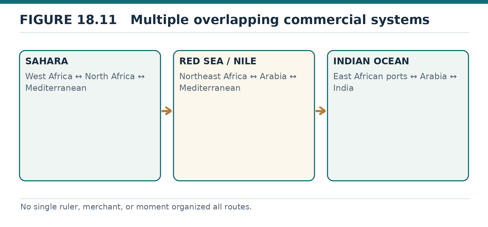

Да разгледаме три припокриващи се търговски системи. В Сахара търговците свързаха пазарите на Sahel и североафриканските градове. На източноафриканското крайбрежие пристанищата координираха размяната на Индийския океан. На Нил и Червено море маршрутите свързвали вътрешните царства със Средиземноморието и Арабия. Тези системи понякога се пресичат чрез по-нататъшна търговия, но нито един търговец не контролира и трите. Те също се промениха по различно време. Мрежова диаграма помага да се покажат връзки, без да се преструват, че всички стоки са следвали един директен маршрут от мина към клиент.

<figure class="figure" id="figure-18-11">

<figcaption>Фигура 18.11. Нито един владетел, търговец или момент не е организирал всички маршрути. <a class="figure-anchor" href="#figure-18-11" aria-label="Link to this figure">#</a></figcaption>
</figure>

Представете си хипотетична верига за обмен с четири посредници между производител-източник и краен купувач. Ако производителят получи 10 единици стойност и всеки посредник добави 20 процента към цената за покриване на разходите и маржа, крайната цена е 10 × 1.2^4 = 20.736 единици. Това изчисление е образователен модел, а не историческа оценка на средновековните африкански търговски маржове. Тя показва, че далечната пазарна цена не може да бъде приравнена на приходите на първоначалния производител. Разходите, рискът, силата на договаряне и политическото данъчно облагане оказват влияние върху разпределението по маршрута.

Политическите власти могат да се възползват от търговията, като таксуват такси, регулират пазарите, осигуряват сигурност или контролират стратегически възли. Но съществуването на вносни луксозни стоки в капитал не доказва, че всеки жител е имал полза. Един град може да забогатее, докато неговият хостерланд осигурява принудителен труд. Един маршрут може да процъфтява за търговците, докато излага пътниците или местните общности на нападение. Връзката създава възможност и неравноправна уязвимост едновременно.
