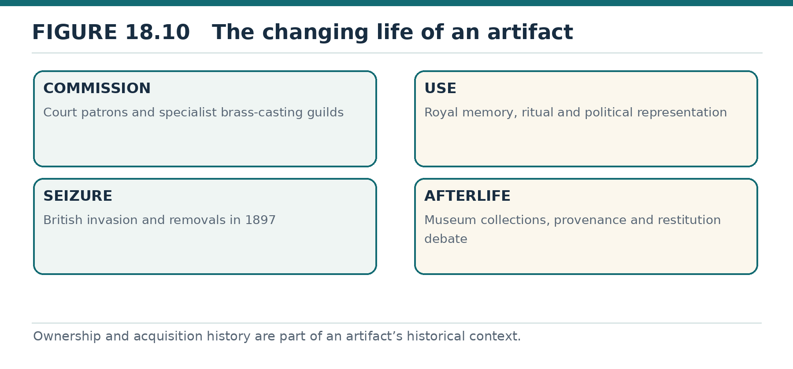

Кралство Бенин, центрирано върху град Бенин в днешна Нигерия, е била голяма говореща полята на Едо. Не е същото като днешната република Бенин. Нейният монарх, Оба, упражнявал власт в един политически свят, който включвал също и длъжностни лица, гилдия на двореца, търговци, градове и съседни общности. Кралската власт се промени с течение на времето и не трябва да се представя като неограничена лична команда. Съдът поръча впечатляващи месингови отливки, слонова кост произведения и издълбани предмети, които съхраняват паметта, йерархията и ритуалните задължения.

Някои възпоменателни месингови плочи изобразяват владетели, войни, прислужници и срещи с чужденци. Тези предмети показват уменията на специалистите по кастинг гилдия и значението на кралски образи. Те могат също така да помогнат за идентифицирането на модели на контакт с португалските търговци и други посетители от края на петнадесети век нататък. Но придворното изкуство отразява преди всичко конкретни покровители и цели; хората, които отглеждат храна, поддържат домакинства и опитни кралски искания често се появяват по-малко директно в образите си.

През 1897 г. британските сили нахлули в град Бенин и премахнали големи количества кралски и свещени предмети. Много по-късно влизат в музеи и частни колекции извън Нигерия. Това насилствено отстраняване има последици за стипендията, както и за културната собственост: предметите се отделят от местата, институциите и архивите, които биха могли да ги обяснят. Сегашните обсъждания на реституцията не са отвличане на вниманието от историята; те се отнасят до това как са били придобити доказателства и как нейното значение и попечителство трябва да бъдат разбрани. Историята на артефакт включва обстоятелствата за неговото оцеляване и движение.

<figure class="figure" id="figure-18-10">

<figcaption>Фигура 18.10. Собствеността и придобиването на история са част от исторически контекст. <a class="figure-anchor" href="#figure-18-10" aria-label="Link to this figure">#</a></figcaption>
</figure>
