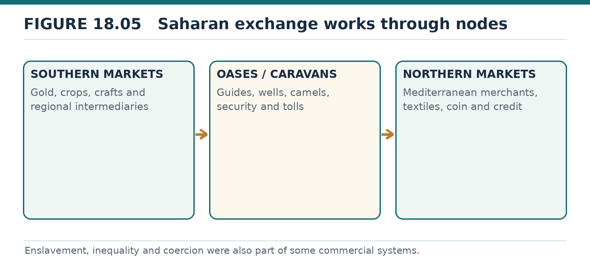

Между ранните средновековни векове и ранния модерен период, транссахарската търговска мрежа свързва части от Западна Африка, Северна Африка и Средиземно море. Камилските каравани били от основно значение за много от тези маршрути, защото позволявали по - дълги пътувания през сух терен. Тяхната ефективност зависела от установените познания за кладенци, сезони, местни управници и пазари. Дори тогава недостигът на вода, данъчното облагане, грабежите и нестабилните съюзи биха могли да заплашат едно пътуване. Икономическата стойност на маршрута никога не е била независима от политическите условия, които правят преминаването по-безопасно или по-опасно.

Златото от части на Западна Африка е особено важно за по-широките търговски системи, а солта от районите за производство на пустинята може да командва търсенето на юг. Но намаляването на транссахарската търговия до размяна на два артикула крие текстил, мед, коне, ръкописи, храна, поробени хора и други стоки, както и човешките последици от принудителната търговия. Поробването съществувало в различни форми в различните общества; маршрутите помагали да се преместят пленници и оформят местните конфликти. Техният опит не трябва да изчезва под празничния език на търговията.

Търговците разчитали на нещо повече от бартер. Доверителните мрежи, кредитните споразумения, споделените религиозни и правни знания и посредниците помогнаха на сделките да пресекат политическите граници. Ислямът създал важни интелектуални и институционални връзки в Сахара, но нито всеки владетел, нито всеки търговец имали едни и същи вярвания, а местните религиозни практики останали влиятелни. Пътищата и караваните разкриват древен урок по мислене на системите: търговските маршрути са мрежи от институции, а не само линии между точките.

<figure class="figure" id="figure-18-5">

<figcaption>Фигура 18.5. Поробването, неравенството и принуда също били част от някои търговски системи. <a class="figure-anchor" href="#figure-18-5" aria-label="Link to this figure">#</a></figcaption>
</figure>
