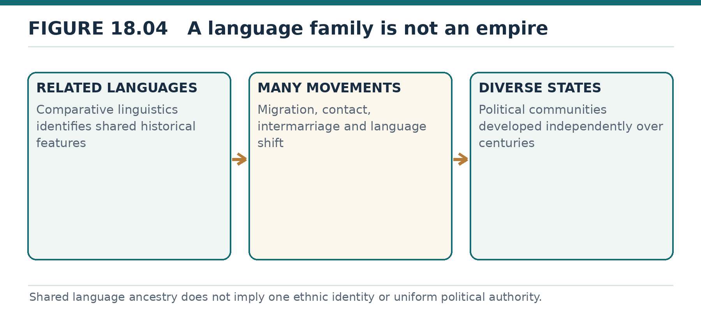

Един от най-големите модели в африканската езикова история е разпространението на Банту езици в широки части на Централна, Източна и Южна Африка в продължение на много векове. Етикетът "Банту" идентифицира езикова група, а не нито една нация, раса, империя или мигрираща армия. Изследователите използват сравнителна лингвистика, археология и генетика, за да изследват движенията, контактите и смесването, които са допринесли за това разпространение. Процесът се разгърна чрез повтарящи се миграции и локални взаимодействия, нито един внезапен марш през празен континент.

Много общности отглеждат култури, отглеждат добитък, работят с желязо и се адаптират към горите, саваните или речните долини в различни комбинации. Технологията може да се разпространи без всеки потребител да мигрира от едно и също място. Езикът може да се разпространи, докато ораторите се женят за установени популации и приемат местни практики. Затова археолозите се противопоставят на изравняването на един керамичен стил с една етническа група или на всяко движение на хора като културна заместител.

Разширяването е от значение, защото те помагат да се обяснят връзките между езиците, говорени днес на места, толкова разделени като Конгоския басейн, Големите езера и Южна Африка. Те не изтриват историята на по-ранните популации или многото небанту езикови общности в целия континент. Езикът е ценна историческа улика, но лингвистичното семейство не е политическа карта.

<figure class="figure" id="figure-18-4">

<figcaption>Фигура 18.4. Споделените езикови предшественици не означават една етническа идентичност или единна политическа власт. <a class="figure-anchor" href="#figure-18-4" aria-label="Link to this figure">#</a></figcaption>
</figure>
