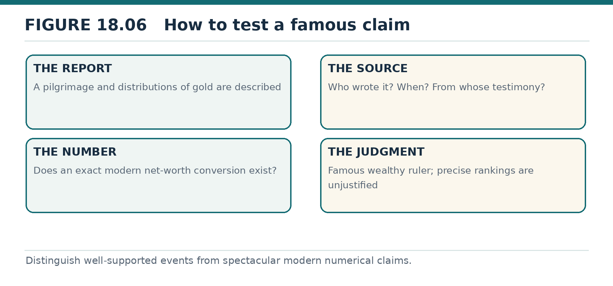

През 1324 и 1325 г. владетелят на Мали Манса Муса пътувал на поклонение до Мека, преминавайки през Кайро. Пътуването привлече вниманието на наблюдателите далеч отвъд Западна Африка, а по-късните разкази описват големи свита и значителни разпределения злато. Често се представя като доказателство, че Муса е "най-богатият човек, живял някога." Такава модерна класация не може да се изчисли смислено от средновековни доказателства: собственост, суверенитет, покупателна сила и лично богатство, управлявани от различни институции, а количествата в оцелелите разкази са несигурни.

Значението на пътуването е по-ясно от популярното му числено разкрасяване. Поклонничеството на Муса свързва Мали с влиятелни мюсюлмански общности и политически мрежи, разпространява богатството на кралството и поддържа взаимоотношения с учени и търговци. Тя също така прави видимо пресичането на царството и религиозния престиж. Пътуването беше както преданостен акт, така и събитие с дипломатически и икономически последици.

Някои хроникьори съобщават за влияние върху цената на златото в Кайро, но мащабът и продължителността на въздействието се обсъждат и зависят от качеството на по-късните показания. Вместо да повтаряме грандиозна оценка, попитайте: кой е записал историята, колко време след събитието, кои количества са правдоподобни и какви други независими доказателства съществуват? Урокът от глави 3 и 4 се прилага тук: прецизността в източника не е същата като увереността в миналото.

<figure class="figure" id="figure-18-6">

<figcaption>Фигура 18.6. Изявления добре поддържани събития от грандиозни съвременни цифрови твърдения. <a class="figure-anchor" href="#figure-18-6" aria-label="Link to this figure">#</a></figcaption>
</figure>
