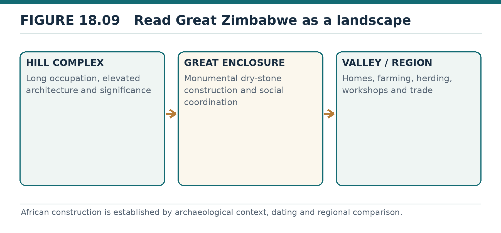

Историята на южноафриканските кралства оспорва всяко предположение, че монументални градове съществуват само близо до Нил или Средиземно море. Mapungubwe, близо до сливането на реките Лимпопо и Шаше в днешна Южна Африка, процъфтява през единадесети до тринадесети век. Археологическият му архив разкрива нарастваща йерархия на селището, търговски стоки, елитни погребения и известен носорог, покрит със злато. Нито един от тези обекти не говори директно, но заедно те показват регионален център, където престижът, властта и обменът са станали тясно свързани.

Голямото Зимбабве, в днешно време Зимбабве, се развило в голям каменен политически център, особено между единадесети и петнадесети век. Нейните стени, проходи и заграждения са свързани с общностите, които са предшественици на говорещите Шона народи. Структурите са построени с внимателно монтиран камък, често без хоросан. Комплексът включваше множество области на окупация и ритуално или политическо значение; той не беше просто един "царски дворец," който се отличаваше от едно безформено население. Богатството му е свързано с добитъка, селското стопанство, регионалния обмен и достъпа до райони за производство на злато.

Археолозите са открили внесени предмети, включително мъниста и керамика, които свързват Great Зимбабве с търговията в Индийския океан. Те не предполагат, че чуждестранните търговци са построили стените си. Писателите от колониалната епоха понякога отричали африканския произход на сайта и изобретявали аутсайдерите като негови архитекти. Археологическите проучвания, датирането и регионалното сравнение решително подкопават тези твърдения. Това е проучване за това как предразсъдъците могат да изкривят въпросите, преди дори да бъдат разгледани доказателствата. Методът има значение: дата на сайта, изучаване на строителството, сравнение на местните материални традиции и съпротива предпочитани митове.

<figure class="figure" id="figure-18-9">

<figcaption>Фигура 18.9. Африканското строителство се основава на археологически контекст, датиране и регионално сравнение. <a class="figure-anchor" href="#figure-18-9" aria-label="Link to this figure">#</a></figcaption>
</figure>
