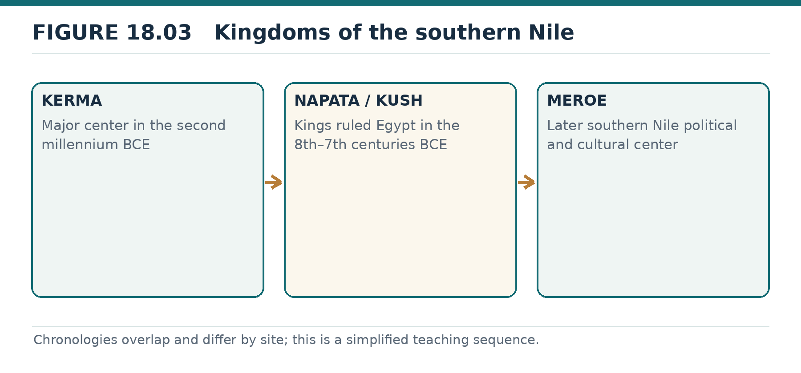

Нил не бил само египетска река. Южна Египет, общностите в това, което сега е Судан разви селскостопански, пасторални и градски традиции със свои собствени политически истории. Керма се появява като важен център през второто хилядолетие пр.н.е., свързан с монументална кална архитектура, богати погребения и регионална сила. Египетските владетели понякога провеждали кампания на юг, докато хората и стоките се движели в двете посоки. Връзката включваше война, размяна, заемане на заеми и съпротива; етикетирането на целия район просто "южната граница на Египет" би накарало съседите да изчезнат от историята.

По - късно едно кралство Кушите, съсредоточено върху Напата, се превърнало в голяма сила. През осми и седми век пр.н.е. владетелите на Кушити управлявали Египет като двадесет и пета династия. Известното наименование "Черните фараони" подчертава техния африкански произход, но може да замъгли отдавна установената културна и политическа изтънченост на южните общества в Нил. Техните лидери използвали египетски религиозни и кралски символи, докато вземали политически решения в собствената си стратегическа среда. Асирийските кампании и изместването на регионалната власт в крайна сметка прекратиха управлението на Кушите в Египет; това не сложи край на самия Куш.

По - късно политическият и церемониален център, свързан с Куш, се преместил към Мерое. Районът подкрепяше отличителното изкуство, архитектурата, пирамидите, писането в меротийския сценарий и мрежите, свързващи Нил с по-широки африкански и червеноморски светове. Обсъдени са степента, организацията и хронологията на производството на желязо; не е разумно да се повтарят опростени твърдения, че всяка мероитска пещ осигурява огромна експортна промишленост. Историята, която оцелява е достатъчно богата, без да се налага преувеличен разказ за цивилизация или изолирано изобретение. Куш е бил участник в по-широката североизточна африканска история, а не просто епизод в историята на Египет.

<figure class="figure" id="figure-18-3">

<figcaption>Фигура 18.3. Хронологията се припокрива и се различава по сайт; това е опростена учебна последователност. <a class="figure-anchor" href="#figure-18-3" aria-label="Link to this figure">#</a></figcaption>
</figure>
