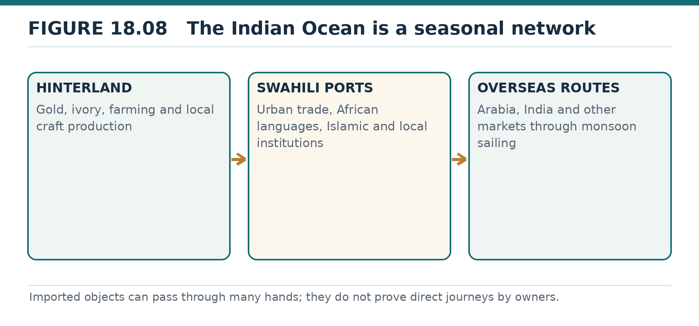

По протежението на източноафриканския бряг общностите развивали пристанища и градове, чиито жители говорели форми на суахили, език на Банту с дълга история на контакти и заемане на заеми. Градове като Килва, Момбаса, Малинди и други са участвали в един индийски свят на търговията в океана, свързващ континентална Африка с Арабия, Персия, Индия и чрез по-нататъшни мрежи - Китай. Ветровете на Монсон помогнаха да се оформи сезонното плаване, но корабите не носеха автоматично богатство. Моряците, пристанищните власти, търговците, занаятчиите и доставчиците на хинтерландия създадоха мрежите.

От средновековието насам някои градове построили къщи и джамии от коралови камъни, окосени монети или получили вносна керамика. Kilwa Kisiwani стана особено важно за обмена на стоки от вътрешната част на Южна Африка, включително злато и слонова кост. Архитектурата му е доказателство за градска организация и ислямски културен живот, докато внесеният порцелан е доказателство за връзки от разстояние. Една порцеланова купа в източноафриканско жилище не доказва, че собственикът ѝ е посещавал Китай: стоките често сменяли ръцете си много пъти преди да достигнат до своите потребители.

Старите колониални разкази понякога твърдяли, че цивилизацията на Суахили трябва да е основана от чужденци, защото неговите градове показвали сложна архитектура и търгували из океаните. Археологията и лингвистичните изследвания силно подкрепят ролята на местните африкански общности в развитието на тези градове, като същевременно демонстрират устойчив международен обмен, стерминални бракове и културна адаптация. Тези констатации позволяват по-богато обяснение: африканският произход и глобалните връзки не са конкурентни алтернативи. Един град може да бъде дълбоко местен и дълбоко космополитен едновременно.

<figure class="figure" id="figure-18-8">

<figcaption>Фигура 18.8. Внесените предмети могат да преминават през много ръце; те не се оказват директни пътувания на собствениците. <a class="figure-anchor" href="#figure-18-8" aria-label="Link to this figure">#</a></figcaption>
</figure>
