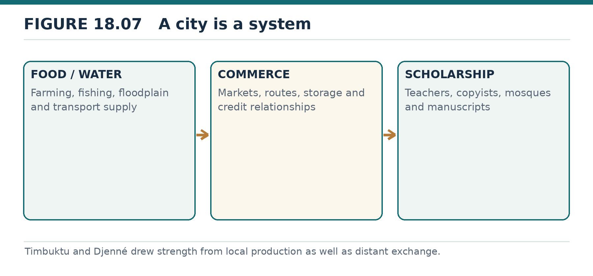

Тимбукту се развива във влиятелен търговски и интелектуален център на южния край на Сахара, свързан с мрежата на река Нигер. Джене и по-широката делта на ВВП Нигер подкрепиха селското стопанство, производството на плавателни съдове и обмена в продължение на дълги периоди. Архитектура, джамии, ръкописи и градски пейзажи показват как стипендията и търговията могат да се засилят взаимно. Значението на градовете се променило с течение на времето; нито било постоянно доминиращо, нито било изолирано от войната и сменяло маршрутите.

Учени в Тимбукту учи области, включително ислямска съдебна практика, теология, граматика и аспекти на математиката и астрономията. Авторитет оцелява в публични и семейни колекции, въпреки че не всеки документ, приписван на града е бил написан там. Те показват традиции на копиране, коментари, собственост и стипендия. Наричайки Тимбукту "африкански университет" може да изрази интелектуалното си значение, но фразата рискува налагането на институционална структура на модерен университет в различен образователен свят от учители, студенти, джамии и частни библиотеки.

Възможно е един посетител да се е сблъскал с няколко социални свята едновременно: търговци на каравани, които организират търговски сделки, търговци на реки, пренасящи зърно, книжници, подготвящи документи, учени, дискутиращи правни въпроси и занаятчии, поддържащи земни сгради. Икономическата устойчивост се основава както на местното производство на храни, така и на отдалечени маршрути. Тези градове усложняват фалшивата опозиция между "африканската устна традиция" и "писмената цивилизация": устното и писменото познание съществуваше помежду си и служеше за различни социални цели.

<figure class="figure" id="figure-18-7">

<figcaption>Фигура 18.7. Тимбукту и Джене черпиха сила от местното производство, както и от далечната размяна. <a class="figure-anchor" href="#figure-18-7" aria-label="Link to this figure">#</a></figcaption>
</figure>
