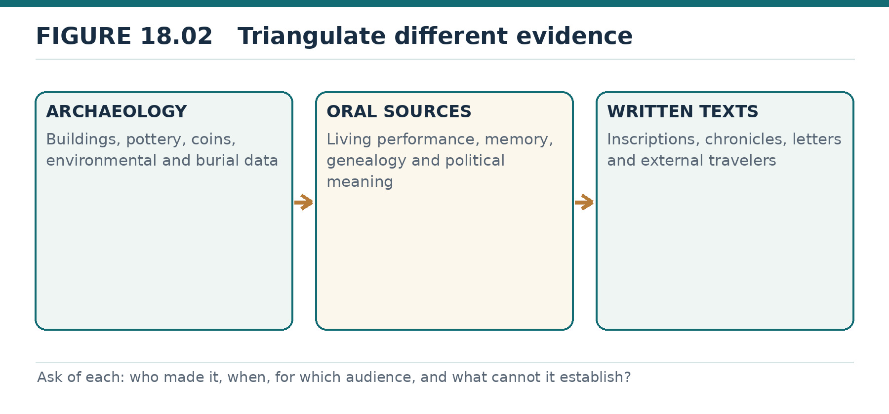

Някои африкански общества издавали писмени хроники, надписи, правни текстове, религиозна литература и кореспонденция. Други са известни особено чрез археология, устни традиции, лингвистична реконструкция, изкуство и предмети, направени за ежедневна употреба. В други случаи писмени наблюдатели от друг регион, например арабскоговорящи географи или европейски нелегални описания, които разкриват ценни детайли, като същевременно носят и недоразумения и предразсъдъци. Една документална празнина не означава, че историята не се е случила. Това означава, че историците трябва да задават различни въпроси на различни форми на доказателства.

Да разгледаме три предмета. Монета, носеща името на крал аксумит, може да помогне дата владетел и осветява държавни претенции, докато неговите метал и място за намиране предполагат търговски връзки. Златно тегло или стъклено топче, намерено от вътрешно селище, може да означава размяна, но не може да идентифицира всеки търговец по пътя си. Царска възпоменателна месингова плоча, направена в Бенин, може да разкрие художествена практика, съдебна йерархия и политически образи, въпреки че това не е неутрално преброяване на кралството. Тези обекти стават по-информативни, когато изследователите ги сравняват с архитектура, екологични открития, радиовъглеродни дати и независими записи.

Устните традиции не заслужават нито автоматично уволнение, нито безкритично третиране като буквални преписи. Те могат да запазят спомените за миграцията, политическата основа, родството и легитимността, но изпълненията се променят в отговор на публиката и сегашните опасения. Историята на Съндиата например се предава чрез западноафрикански епични традиции, чиито версии и цели варират. Това е доказателство за паметта и авторитета, дори когато точните събития не могат да бъдат потвърдени. Добрият историк държи два въпроса отделно: какво казва традицията и какво можем да установим независимо за миналото?

<figure class="figure" id="figure-18-2">

<figcaption>Фигура 18.2. Попитайте всеки: кой го е направил, кога, за коя публика, и какво не може да установи? <a class="figure-anchor" href="#figure-18-2" aria-label="Link to this figure">#</a></figcaption>
</figure>
