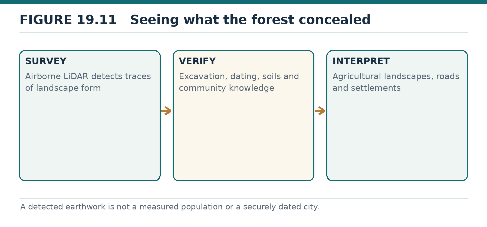

В продължение на дълго време много сметки описват басейна на Amazon като до голяма степен немодифицирани пустини, чиито почви не могат да подкрепят широкомащабното селище. Изследванията все повече показват по-разнообразно минало. Общности модифицирани пейзажи чрез управлявани гори, отгледани полета, канали, пътища, риба weirs, засадени дървета и селища в различни плътности. Известният термин "terra preta" се отнася до плодородни тъмни почви в някои амазонски райони, свързани с дълги истории за човешка дейност. Но едно откритие не доказва, че всяка част от огромния басейн съдържа градове.

LIDAR.Light неоткриваемост и обем е особено разголен. Лазерните измервания, базирани на летателни апарати, могат да помогнат на изследователите да моделират формата на земната повърхност под части от гъста растителност. Изследването от 2024 г. на Еквадорската долина "Упано" документира мрежите от платформи, площади, селскостопански характеристики и пътища, свързани с разширена история на урбанизма с ниска плътност. Изследванията на касарабската култура в днешна Боливия също са идентифицирали земните работи и свързаните с тях селищни пейзажи, а последвалите доказателства са засилили отчетите за интензивното производство на царевица там. Това са значителни открития, защото те отхвърлят фалшивия избор между "гъстия каменен град" и "празната гора."

Образът LIDAR не е машина на времето. Тя открива форми в пейзажа; археолозите все още трябва да тестват дати, строителни фази, функции и възможни взаимоотношения между характеристиките. Правоъгълен възход може да бъде древна платформа или продукт на по-късен процес, докато контекстът се изучава. Прогнозите за населението и регионалната интеграция остават несигурни и не всички характеристики са били непременно заети едновременно. Нови технологии разширяват видимия архив, но внимателните полеви дейности и местните знания остават от съществено значение за тълкуването.

<figure class="figure" id="figure-19-11">

<figcaption>Фигура 19.11. Откритите земни дела не са измерено население или град със сигурна дата. <a class="figure-anchor" href="#figure-19-11" aria-label="Link to this figure">#</a></figcaption>
</figure>
