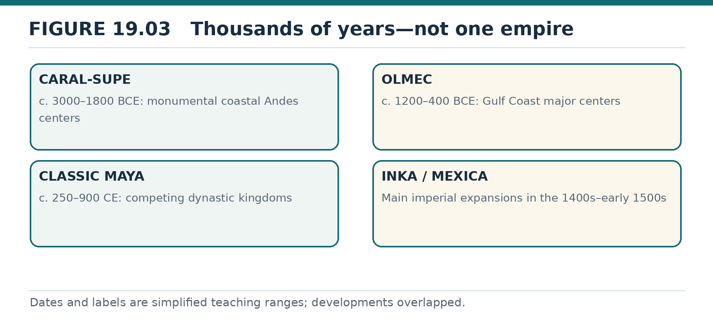

На тераса над Супската долина на крайбрежна Перу монументалният център на Карал формира част от по-широк пейзаж от селища. Археологическите запознанства поставят основното му развитие в третото и началото на второто хилядолетие пр.н.е., често обобщавано като около 3000 год. пр.н.е. Сайтът съдържа големи платформи, площади и доказателства за организирана дейност. Тъй като крайбрежната пустиня е изключително суха, управлението на речните води и връзките с поточната долина са важни. Близо до крайбрежните общности също така са се възползвали от морските ресурси, създавайки възможности за обмен между вътрешни култури и морски дарове.

Карал илюстрира както постигането, така и интерпретативното въздържание. Монаменталната архитектура показва мобилизацията на труда и споделените цели; тя сама по себе си не разкрива точна конституция, имената на владетелите или една "първа империя." Археолозите не са съгласни за баланса между религиозната власт, икономическата координация, йерархичната власт и многото общности. Трябва да устоим да заменим мит за непроменящата се простота с еднакво неподдържан мит за всевластна древна държава.

Хронологията на Карал е важна за глобалното сравнение. Тя се развива много преди класическата Мая или империята на инките. Наричайки и трите "древни Перу" криели многото векове, в които ги разделяли. Същата география многократно била реорганизирана от по - късните народи, но те не живеели в една непрекъсната империя. Когато историците казват, че една цивилизация е била "ранна," те трябва да определят рано в сравнение с какво и кои елементи се сравняват със селскостопанските укрепления, монументалното строителство, политическата интеграция или писането.

<figure class="figure" id="figure-19-3">

<figcaption>Фигура 19.3. Датите и етикетите са опростени диапазони на преподаване; събитията се припокриват. <a class="figure-anchor" href="#figure-19-3" aria-label="Link to this figure">#</a></figcaption>
</figure>
