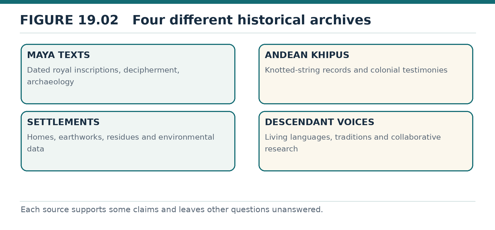

Източниците се различават рязко по региона. В градовете на Маите каменните паметници и оцелелите рисувани или писмени материали дават на учените пряк достъп до някои дати, владетели и събития. В Централна Мексико местните изложбени истории, колониални ръкописи и археологически останки помагат за възстановяването на близкото предизвикателство, въпреки че всички се нуждаят от внимание кога и защо са направени. В Андите архитектурата, пътищата, щатските складове, текстила и клиновидните звукозаписни системи са от съществено значение, а след завоеванието са записани много писмени показания. На друго място, моделите на селище, почвата, животинските кости, керамиката, погребалните практики, пейзажите и потомствените устни истории могат да носят основната очевидна тежест.

Писмените източници не са по същество безпристрастни. Издълбаната декларация за победата на крал Мая ни казва какво иска съдът да си спомни, а не непременно целия военен резултат. Описанието на испанския завоевател на един град може да запази ценни детайли, докато също така напредва политически случай с отвъдморски монарх. Акаунтът на един мисионер може да записва местните вярвания, докато ги превежда чрез непознати категории. Археологически етаж, дворцов надпис и по-късна устна традиция могат да отговорят на различни въпроси. Силни истории тест, където независими линии на доказателства се срещат и заявяват открито, когато те не го правят.

Местните общности не са само обект на научни изследвания. Техните езици, стюардеси, устни традиции и участие могат да трансформират археологически въпроси и интерпретации. Имената като "Aztec" и "Inca" са удобни, но неточни етикети, когато се използват сякаш описват всеки човек в една империя. Mexica често се отнася по-специално до хората, съсредоточени върху Tenochtitlan и Tlatelolco; Tawantinsuyu се отнася за имперската област Inka. Дори "Мая" описва много свързани, но различни общности през времето. Историческият етикет е инструмент, а не заместител на прецизността.

<figure class="figure" id="figure-19-2">

<figcaption>Фигура 19.2. Всеки източник подкрепя някои твърдения и оставя други въпроси без отговор. <a class="figure-anchor" href="#figure-19-2" aria-label="Link to this figure">#</a></figcaption>
</figure>
