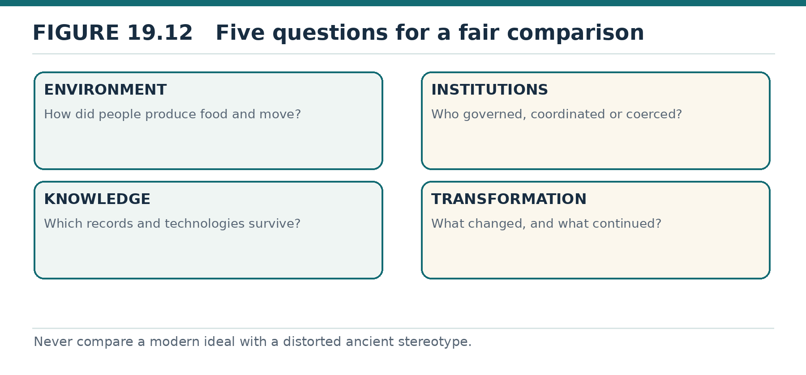

Три сравнения разкриват защо етикетите имат значение. Класическите градове на Маите били управлявани чрез конкуриращи се династични кралства, а не чрез обединена империя на маите. Воденият от Мексика Троен алианс се разшири чрез връзки с притоци, свързани със закърпване на местните сили, докато капиталът му привлече интензивно управлявана езерна икономика. Tawantinsuyu координира огромни трудови и комуникационни системи през планини и пустини. Всички форми на йерархия, ритуална сила, политически преговори и конфликт; те се различаваха по административни технологии, териториална организация и отношенията между местните и централните елити.

Разнообразните политически договорености на Северна Америка са също толкова важни. Кахокия е бил популационен церемониален и политически център в рамките на Мисисипийските мрежи, докато древният Пуебло свят включва промяна на регионалните общности и споделени архитектурни традиции. Други нации организираха съвети, дипломация, връзки с клана и сезонно движение, без да строят сравнително големи паметници. Не бива да се нареждат общества по приликата им с Рим. По-добри въпроси се отнасят до устойчивостта, социалното участие, екологичното управление, принуда, легитимност и доказателства.

Полезно разграничение е между цивилизацията като широка историческа и културна категория, държава като форма на организирана политическа сила, град като вид селище и империя като разширена енергийна връзка между различните групи. Това не са синоними. Местните общества биха могли да имат широкообхватна култура без една държава; могъщ град би могъл да съществува, без да управлява всяка близка общност. Терминът "предколумбийски" също е хронологично удобство, а не местно самоописание или декларация, която по-късната история не се брои.

<figure class="figure" id="figure-19-12">

<figcaption>Фигура 19.12. Никога не сравнявай модерен идеал с изкривен древен стереотип. <a class="figure-anchor" href="#figure-19-12" aria-label="Link to this figure">#</a></figcaption>
</figure>
