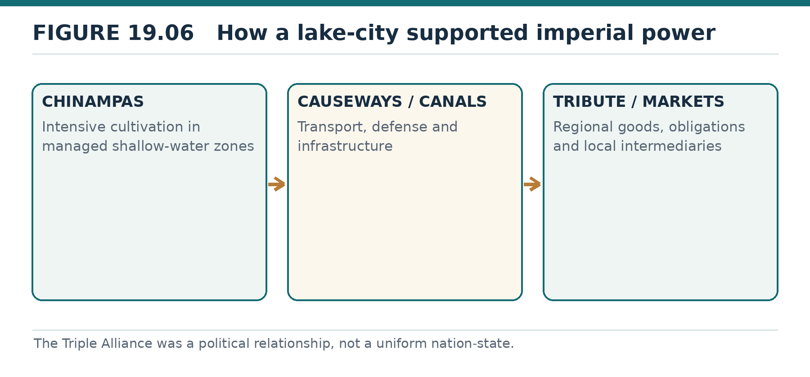

Мексиката създава Тенохтитлан на островите в езерото Текскоко, традиционно датираща от 1325 г. в техните по-късни исторически разкази. През петнадесети век една коалиция, наречена "Троен алианс" - Тенохтитлан, Тексоко и Тьопан, разширила властта си. Трибутните задължения на завоюваните общности осигурявали стоки, труд и политическо признание, но администрацията не била идентична навсякъде. Местните елити често оставаха важни и съпротивата се повтаряше. Съвременната стенография "Ацтекска империя" обикновено се отнася до господството на коалицията, а не до държава с единни граници и гражданство.

Мащабът на Тенохтитлан се основавал на инженерството и търговията, както и на войната. Издигнати пътища, свързани с островния град към брега; акведукти и управление на водите се отзоваха на градските нужди; пазарите разпространиха продукти от околните райони; а отглеждането на Китаймпа генерира интензивно производство на храна в подходящи плитки язовирни среди. Чолула, Тлейтълко, Текскоко и други центрове бяха част от много по-голям политически и икономически свят. Прогнозите за населението на столицата варират и уверените кръгли числа следва да се третират като оценки, а не като факти от преброяването.

Религията и военната сила били преплетени. Публичната церемониална практика, жертвоприношение и имперска идеология са от значение за управлението на елитите, но сензационните описания, написани след завладяването, често изискват проверка и контекст. Принудителният труд, почитта, отвличането на пленници и съпротивата бяха истински политически въпроси; така бяха занаятчийските умения, поезията, образованието и рутината на обикновените домакинства. Един добър разказ отказва да направи един драматичен аспект за цяла цивилизация. Той също така си спомня, че хората, които се изправиха срещу испанските сили през 1519 и 1521 г., включваха много местни групи с противоречиви цели, а не просто състезание между две хомогенни страни.

<figure class="figure" id="figure-19-6">

<figcaption>Фигура 19.6. Тройният Алианс беше политическа връзка, а не единна национална държава. <a class="figure-anchor" href="#figure-19-6" aria-label="Link to this figure">#</a></figcaption>
</figure>
