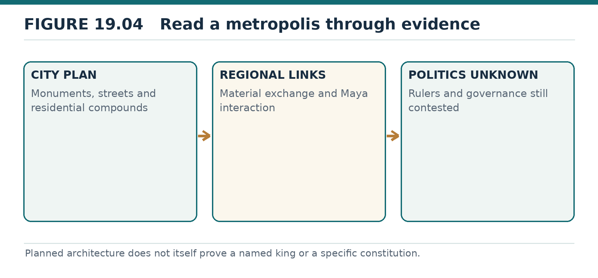

Пътешественик, който влизал в Теотиуакан в центъра на Мексико през процъфтяващите векове, се сблъсквал с монументални платформи, жилищни съединения и един необикновен организиран пейзаж. The Avenue of the Dead, the Pyramids of the Sun and Moon and the complex associated with the Feathered Serpent формира част от град, чието планиране следва общи пространствени принципи. Теотиуакан се разширявал особено през първите столетия на СЕ и имал голямо регионално влияние, преди централните институции да отпаднат през шести и седми век. Населението му се оценява на високи нива, но точните общи стойности варират в различните проучвания и определения на градската зона.

Жилищни съединения и материали намират място в един социално разнообразен град, с занаятчийско производство и хора, свързани с различни региони. Политическата власт е по-трудна за възстановяване отколкото могат да намекнат каменните паметници. За разлика от много центрове на класическите маи, Теотиуакан не е дал на историците сигурно разбрана линия на назовани царски владетели. Някои учени са изследвали възможностите за по - колективни уговорки, докато други подчертават силните елити и принудителните институции. Нито един модел не трябва да бъде представян като доказан извън дебата.

Неговото влияние достигна отвъд долината на Мексико. Връзките с градовете на Маите са видими в материалната култура, архитектурата и епизодите, записани в надписите на маите; точните значения на конкретни взаимодействия остават дискутирани. По-късно прекъсването на Теотиуакан включваше изгаряне в части от центъра и голяма демографска и политическа промяна. Но "градът изгорял" не е напълно причинно-следствена теория. Вътрешният конфликт, стресът върху околната среда, политическите катаклизми и променящите се мрежи бяха разследвани с различни степени на подкрепа. Нито Теотиуакан е същия град или полити, както много по-късно Mexica Tenochtitlan.

<figure class="figure" id="figure-19-4">

<figcaption>Фигура 19.4. Планираната архитектура сама по себе си не доказва крал или конкретна конституция. <a class="figure-anchor" href="#figure-19-4" aria-label="Link to this figure">#</a></figcaption>
</figure>
