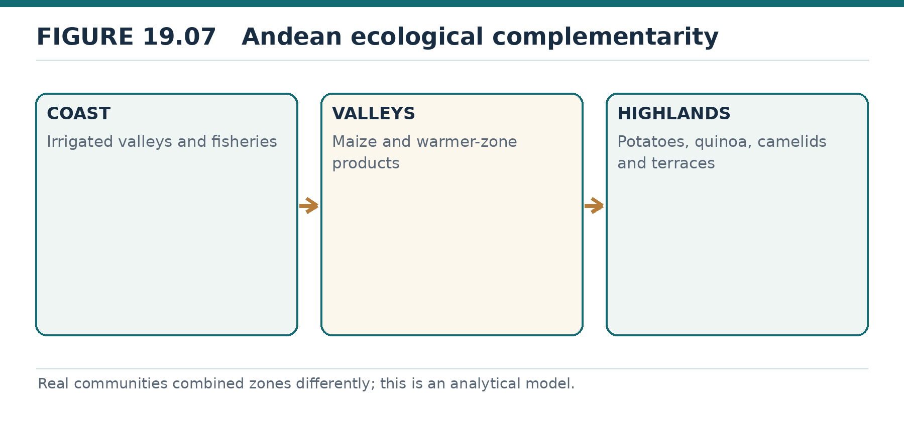

Андите се простират по западния край на Южна Америка, създавайки драматично различни условия на къси разстояния. На тихоокеанското крайбрежие дъждът е оскъден в много долини, но реките, спускащи се от планините, позволяват напояване. По-нагоре фермерите развиват практики, подходящи за променливи височини, студове и стръмен терен. Източните склонове се свързват с облачните гори и Амазонските райони с друг набор от продукти. Фразата вертикална икономика описва една важна андска стратегия: общностите търсят достъп, пряко или чрез обмен, до производствени зони при различни повишения.

Домакинството може да зависи от картофите и камилите в покрайнините, царевицата в по - топлите долини и стоките, получени чрез търговия с низини или крайбрежни общности. Но това не е вечна формула, приложена еднакво във всички Андски общества. Контролът на пътищата, напояването, стадата, съхранението на култури и ритуалните центрове могат да организират политическата власт по различни начини. Крайбрежният риболов и интензивното земеделие бяха особено важни в някои региони. Затова андийските историци трябва да работят върху множество мащаби, от местен канал до пътна система, пресичаща хиляди километри.

Андите също ни напомнят, че сложните технологии не трябва да приличат на средиземноморските или китайските примери, срещани в по-ранните глави. Фината текстил може да бъде регистър на състоянието и знанията; каменната конструкция може да издържи труден терен; и воденето на записи може да работи чрез завързани въжета. Въпросът не е защо тези общества не копираха евроазиатските институции. Въпросът е как са изградили ефективни системи от собствените си ресурси, опит и политически избор.

<figure class="figure" id="figure-19-7">

<figcaption>Фигура 19.7. Реалните общности комбинират зони по различен начин; това е аналитичен модел. <a class="figure-anchor" href="#figure-19-7" aria-label="Link to this figure">#</a></figcaption>
</figure>
