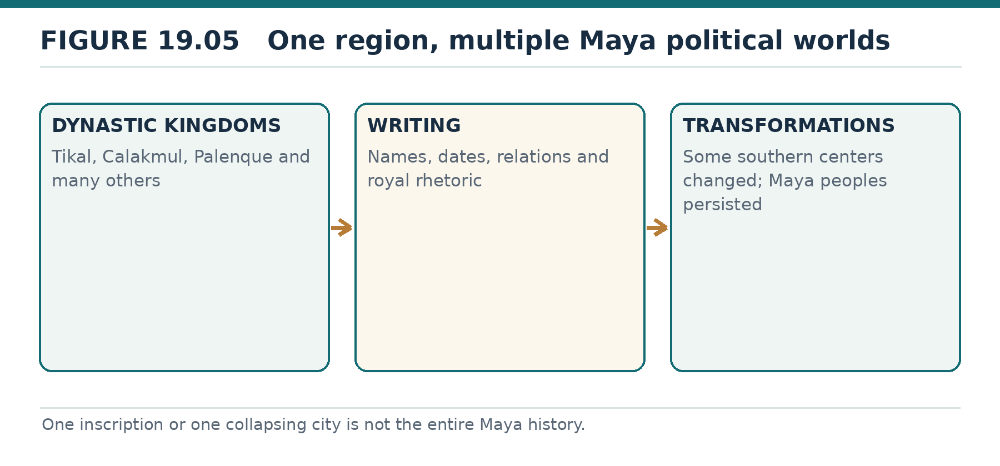

Маите окупирали широк регион, който включва части от южно Мексико, Гватемала, Белиз, Хондурас и Ел Салвадор. Тяхната история се простира през дълги периоди и продължава в настоящето чрез живи общности и езици на Маите. Те никога не са били еднакво управлявани от една "Империя Мая." В класическия период, около 250...900 CE като конвенционална хронологична рамка, мощни царства се състезаваха, договорени бракове, формираха съюзи и инсценирани ритуали в центрове като Тикал, Калакмул, Паленке и Копан. Много други селища варираха от селца до значими градове и градове-държави.

Кралските паметници често записвали присъединяването, войната, предците и церемониалните събития. Това богатство на писане прави части от политическата история на Маите необичайно ярки. Но съдебните текстове подкрепят династиите и политическото представяне. Случилото се във ферми, кухни, пазари или по-малки общности трябва да бъде възстановено с археологически и екологични данни. Градът не съществува само на площада в двореца. Язовири, издигнати полета, тераси и други адаптации са от значение в регион, където наличието на вода варира значително през пейзажите.

Думата "колапс" лесно се злоупотребява в историята на Маите. Между осми и десети век много южни низини изгубили владетели или страдали от упадък на населението, а паметниците престанали да бъдат поръчани по познати начини. Но хората не са изчезнали, нито е завършила цивилизацията на Мая. Важните северни центрове се развивали или упорствали; общностите продължавали из региона и оцелявали днес. Подхвърли доказателства, войни, екологичен натиск, политическа разпокъсаност и цената на поддържането на съдилища всички фигура в научни обяснения. Тяхното значение се различаваше от местоположението и времето, така че една единствена история не е достатъчна.

<figure class="figure" id="figure-19-5">

<figcaption>Фигура 19.5. Един надпис или един срутващ се град не е цялата история на Маите. <a class="figure-anchor" href="#figure-19-5" aria-label="Link to this figure">#</a></figcaption>
</figure>
