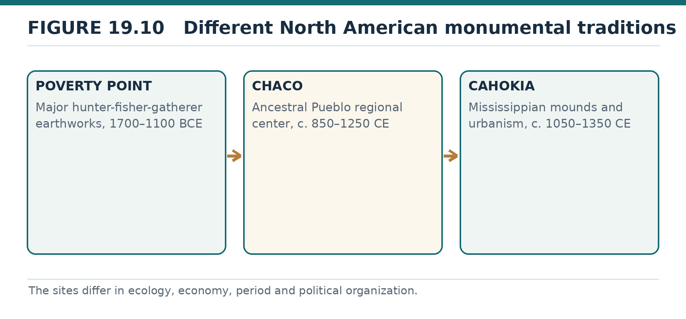

В Източна Северна Америка монументалните земни работи имат дълбока и разнообразна история. Комплексът на Бедността в Луизиана, с големите си хребети и могили, е използван между 1700 и 1100 г. пр.н.е. Нейната значимост поставя под въпрос предположението, че само големи зърнена култура държави могат да организират големи паметници. По - късно обществата в долината на Охайо построили обширни церемониални земни работи и общностите из цяла Източна Северна Америка развили различни земеделски, търговски и ритуални традиции. Тези събития не са епизоди на една култура, която просто променя името си.

До около 1050 CE, Чахокия, близо до съвременния град Сейнт Луис, става основен център в рамките на Мисисипийския свят. Неговите монументални могили, планирани пространства и околни селища показват концентрирана социална сила и регионални връзки. ЮНЕСКО описва голямо население на своя връх, което обикновено се оценява в широк диапазон, а не чрез преброяване. Селското стопанство подкрепя много мисисипийски общества, но отношенията между политиката, ритуалната власт, занаятчийското производство и регионалния обмен остават отворени за изучаване. Монаси Моунд е подвиг на координирано строителство, но не можем да прочетем оцеляла кралска хроника, идентифицираща всичките му строители.

По-късно, политическата контракция на Кахокия не е била изчезването на народа му или внезапното прекратяване на местната цивилизация в долината Мисисипи. Населението, селищата и традициите се промениха; по-късно местните народи запазиха сложен политически и културен живот. Терминът "музикални строители" някога е бил злоупотребяван от писатели, които отричат заслугите на коренните народи за древни конструкции. Археологически доказателства и местни истории твърдо определят тези земни работи като индиански постижения. Тук самата история на археологията дава урок за предразсъдъците, засягащи интерпретацията.

<figure class="figure" id="figure-19-10">

<figcaption>Фигура 19.10. Обектите се различават по екология, икономика, период и политическа организация. <a class="figure-anchor" href="#figure-19-10" aria-label="Link to this figure">#</a></figcaption>
</figure>
