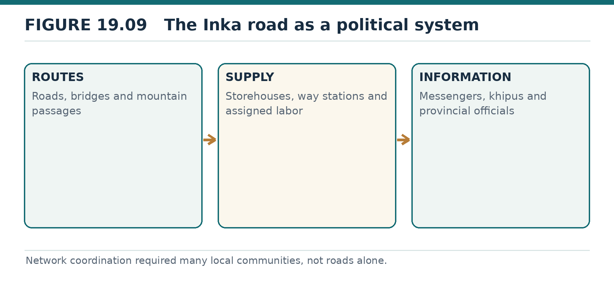

Едно от най-забележителните постижения на Tawantinsuyu е Qhapaq nan, обширна пътна мрежа с секции, построени много преди разширяването на Inka. Пътищата пресичат високи планински проходи, свързани долини и административни центрове и изискват мостове, пътни станции и постоянна поддръжка. ЮНЕСКО описва система от повече от 30 000 километра, въпреки че изчисленията зависят от броя на маршрутите и свързаните сегменти. Тези пътища позволиха на официалните посланици, движение на стоки и войски, надзор и церемониални пътувания; те не бяха павирана пътна система за колесни колички.

Пътят не е бил изолиран. Държавните складове са държали доставки; релета куриери можеха да пренасят информация; местните общности осигуряваха труд и поддръжка; и длъжностни лица координираха трансфери. Мисли за системата като верига от връзки, чийто провал във всеки един момент може да наруши дейността другаде. Командващият владетел в Куско бил силен само дотолкова, доколкото администраторите, превозвачите, земеделските стопани и местните лидери поддържали тези връзки. Инфраструктурата е форма на политически капацитет, а не просто техническо постижение.

Да разгледаме едно изчисление на учението. Ако един бегач може да предаде съобщение по 25 км маршрут всеки час в идеализирана система от непрекъснати разклонения, 300 километра ще изискват 12 часа. Истинските пътувания зависели от терена, издигането, персонала, почивката, времето и вида на съобщението. Ние не получаваме историческо време за изпращане на инка от измислена константа. Изчисленията илюстрират значението на ясните предположения при оценката на твърденията за удивителни скорости на комуникация.

<figure class="figure" id="figure-19-9">

<figcaption>Фигура 19.9. Мрежовата координация изисквала много местни общности, а не само пътища. <a class="figure-anchor" href="#figure-19-9" aria-label="Link to this figure">#</a></figcaption>
</figure>
