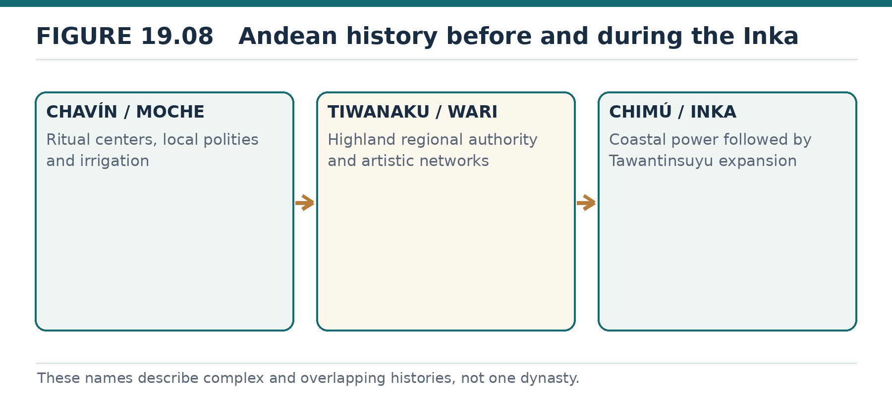

Около езерото Титикака, Тиванаку развива влиятелен церемониален и политически център през първото хилядолетие от н.е. Монументална архитектура, каменна скулптура и сложен земеделски пейзаж са я направили централна за Андската история. По-на север в централните възвишения, властта на Вари и културните стилове се разпространяват из обширни територии с планирани селища, текстил и керамика, които предлагат важни улики. Тези полити взаимодействаха с други общности, но техните форми на разширяване и управление не бяха непременно идентични.

И двете са претърпели големи трансформации около края на първото хилядолетие и след това. Учените изследват натиска върху околната среда, политическата конкуренция, реорганизирането и други местни причини, без да превръщат "колапса" в изчезването на цели популации. След тези трансформации се появили силни регионални царства и градове. На северното крайбрежие на Перу държавата Чимун развива столицата си в Чан Чан и организира големи напоявани територии. Неговото инженерство и администрация предшествали завладяването на района от Инка, което показвало как по - късно империите наследили, приспособили и понякога пригодили по - ранни системи.

Тази последователност е от съществено значение за избягване на погрешното впечатление, че Инка е изобретила Андската сложност от нищото. Пътищата, напоителните познания, административните практики, визуалните традиции и политическите институции имат дълга история. Също така Инка не просто наследила непроменен пакет. Те реорганизирали много съществуващи ресурси в разширяваща се императорска рамка, която зависела както от местните общности, така и от тях. Графика с последователни имена никога не трябва да заличава хората, живеещи през тези промени.

<figure class="figure" id="figure-19-8">

<figcaption>Фигура 19.8. Тези имена описват сложни и припокриващи се истории, нито една династия. <a class="figure-anchor" href="#figure-19-8" aria-label="Link to this figure">#</a></figcaption>
</figure>
