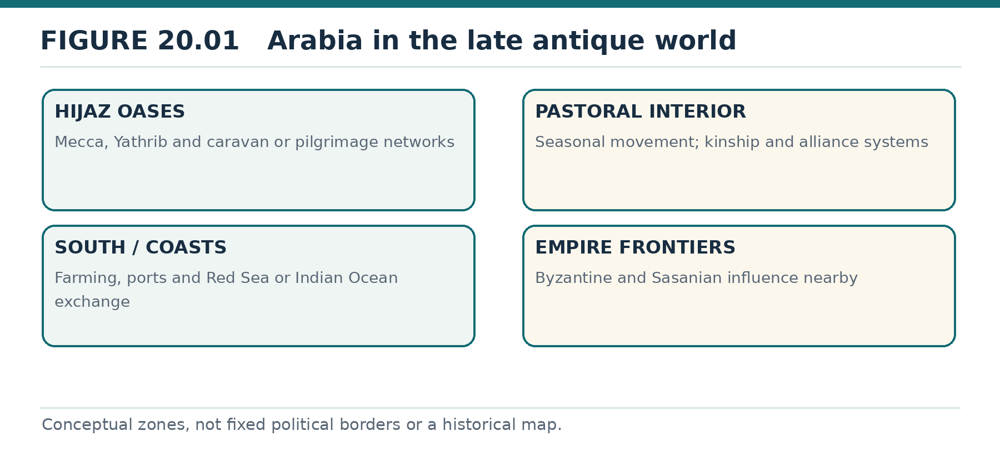

Арабският полуостров няма единна икономика или политическа система. В западната Хиджаз, Мека и Ятриблер известни като Медина, свързани с поклонението, регионалната търговия и оазисния живот. Южна Арабия има отдавна установени селскостопански и търговски традиции; крайбрежните райони свързват полуострова с Червено море и Индийския океан. В много други области, мобилният пасторализъм и племенните или родствени задължения помогнаха на хората да управляват оскъдни пасища и вода. Киншип не означаваше, че всяка връзка е биологична. Съюзи, покровителство, връзки с клиенти и договорена защита също са от значение.

Географията обяснява разнообразието на полуострова. Интериорът може да подпомага сезонното движение; концентрираното земеделие и обмен на оазиси; морските пътища, свързани с южните пристанища в Източна Африка и Южна Азия. Подвеждащо е да се описват всички жители на Арабия като пустинни номади или да се представи един единствен племенен кодекс, който управлява всеки. Арабските общности също така взаимодействали с по-широкия късен античен свят: източната римска, или византийска, империя на северозапад и сасанската персийска империя на североизток. Тяхното съперничество достигна до Арабия чрез дипломатически клиенти, гранични кралства и конкурентни религиозни и търговски връзки.

В Арабия също имало различни религиозни традиции. Местни култове и свещени места, съжителствали с еврейски и християнски общности, заедно с отделни личности и групи, привлечени към монотеизма. Кааба на Мека е важно светилище в по-късна ислямска традиция и Корана многократно се обръща към публика, запозната с историите на Авраам и дебатите за божествената власт. Да кажем, че Ислямът се е появил в този свят не означава да се намали значението му на околните влияния. Историците описват социалната обстановка и наличните източници; вярващите също разбират откровението на Мохамед като божествено събитие. Това са различни видове обяснения и една внимателна книга ги отличава, вместо да принуждава едната да се представя за другата.

<figure class="figure" id="figure-20-1">

<figcaption>Фигура 20.1. Концептуални зони, не фиксирани политически граници или историческа карта. <a class="figure-anchor" href="#figure-20-1" aria-label="Link to this figure">#</a></figcaption>
</figure>
