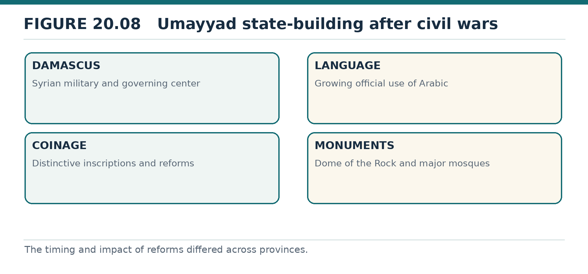

Под Абд ал-Малик (685.705 г.) и неговите наследници, държавата Умайяд развивала разпознаваемо ислямски имперски форми. Арабски заема все по-официална роля в централната администрация, въпреки че заместването на по-стари бюрократични езици се случва с различни ставки в провинциите. Монетажът е дошъл да използва отличителни надписи и дизайни, вместо просто да възпроизвежда византийски или сасанийски модели. Паметническата сграда помогнала да се обявят религиозните и политически претенции на династията. Куполът на Скалата в Йерусалим, завършен около 691.692, е особено важен: нейните надписи, архитектура и разположение комуникират послания за монотеизъм и власт в рамките на град свещен за множество религиозни общности.

Държавата също е построила или разширила джамиите, поддържа пътищата и подкрепя градските институции. Умайяд изкуството привлече византийските, сасанските и местните традиции, докато разработваше нови официални решения. Голямата джамия на Дамаск, построена под Ал-Уалид I в началото на осми век, показва мащаба на императорската религиозна архитектура. Мозайките и градската обстановка разкриват обмен, както и политическа амбиция. Един владетел може да твърди, че управлява разширяващата се мюсюлманска полити, докато използва занаятчии и административни техники, оформени от по-ранни светове.

Тук познато разграничение въпроси: Арабизацията е нарастващата употреба на арабски език и културни форми; ислямизацията е разпространението на исляма като религиозна идентичност и практика. Те често взаимодействаха, но не бяха един и същ процес. Един арабски говорещ християнин не станал мюсюлманин само защото един офис използвал арабски език, а персийският мюсюлманин не трябвало да изоставя персийската култура, за да принадлежи на мюсюлманската общност. През вековете тези процеси са създали свят, по-разнообразен от категорията "Арабска империя."

<figure class="figure" id="figure-20-8">

<figcaption>Фигура 20.8. Времето и въздействието на реформите се различават в отделните провинции. <a class="figure-anchor" href="#figure-20-8" aria-label="Link to this figure">#</a></figcaption>
</figure>
