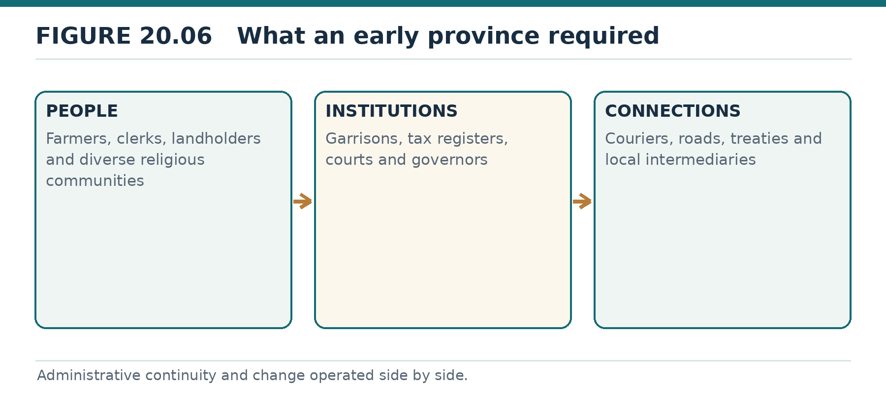

Завоеванието е събитие; правителството е непрекъсната задача. Ранните мюсюлмански владетели трябвало да хранят войниците, да разрешават спорове, да финансират военни експедиции и да поддържат селскостопанската продукция. Гарисонови градове като Куфа и Басра в Ирак, и Фустат в Египет, станаха важни центрове на военен, административен и по-късен интелектуален живот. Те не бяха просто лагери. С течение на времето те развиват квартали, пазари, джамии, политически фракции и научни институции. Техният растеж променил местното общество, дори когато моделите на селско земеделие останали много по-стари.

Много администрация продължи да разчита на длъжностни лица и процедури, наследени от византийците и сасаняните. Гръцки, коптски, персийски и други езици остават значими в местните архиви, докато арабските стават все по - видни. Данъчните договорености варират по време, регион и правна категория. По-късно юристите отличиха Харадж, често свързан с приходите от земя, от Джизия, често свързван с такса за анкетиране на допустими немюсюлмански теми; прилагането на напълно систематизирани по-късни определения без квалификация за всяка област от седми век би било анахронизъм. Това, което е от значение за данъкоплатците, често е действителната оценка, метод на събиране и възможност за обжалване.

Обектите не са взаимозаменяеми. Християнски манастир, еврейска общност, земевладелец от Зороастрийски произход, нов мюсюлманин и арабски военен заселник биха могли да изпитат управляващия ред по различни начини. Институцията, известна като dhimma, се превърна в рамка на защитен, но неравнопоставен статут за признати немюсюлмански общности под много мюсюлмански правителства. Подробностите са различни. Понякога защитата предлагала стабилност спрямо жестоките военни условия; в други случаи дискриминацията, по - тежките тежести или принудителния натиск били реални. Историческото задължение не е нито да романтизираме хармоничното съжителство, нито да отричаме съвместното съществуване, което се е случило.

<figure class="figure" id="figure-20-6">

<figcaption>Фигура 20.6. Административна приемственост и промяна, управлявани рамо до рамо. <a class="figure-anchor" href="#figure-20-6" aria-label="Link to this figure">#</a></figcaption>
</figure>
