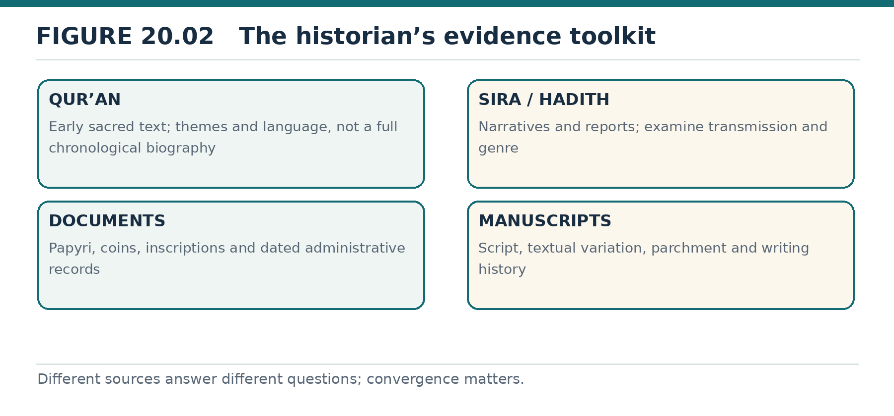

Седми век е сравнително близо до нас, когато се измерва срещу древна Месопотамия, но възстановяването на ранна ислямска история все още представлява сериозни проблеми с източника. Коранът е централният свещен текст на исляма и жизненоважен ранен свидетел на религиозните идеи и речника на движението. Тя не е подредена като хронологична биография. Подробни разкази за живота на Мухаммед се появяват в по-късната сирска литература; доклади за неговите поговорки и практики се появяват в колекциите на Хадит, които са били систематично събрани и оценени през поколенията. Ранни исторически произведения, административни папири, надписи, монети, архитектура и оцелели Коранови ръкописи предоставят други видове доказателства.

Всеки източник отговаря на различен въпрос. Коранският пасаж може да установи езика и загрижеността на текста, но не може независимо да идентифицира точната дата на епизода. По-късна биография може да запази по-стари доклади, като същевременно отразява интересите и конвенциите на предаването му. Монета може да установи кой владетел или религиозна формула правителството официално показва, но не и вътрешните убеждения на всеки, който я използва. Датираният надпис определя някои имена и претенции, като същевременно оставя по-голям политически разказ непълен. Това са причини да се разследват източници, а не причини да се отхвърли миналото като неузнаваемо.

Мюсюлманските учени разработили сложни методи за оценка на предадените доклади, включително проверка на веригите на предаване и разказвачите. Съвременните историци също изследват жанра, датирането, потвърждението и евентуално ретроспективно оформяне. Двата метода се припокриват в някои опасения, но не са идентични. Една почтителна историческа глава може да заяви, например, ислямската традиция е свързана.....където детайлите главно оцеляват в по-късните сметки, и надписите записи.....когато съвременен обект директно свидетелства за иск. Нито една фраза не е подигравка. Прецизността защитава както научната честност, така и религиозните дискусии.

<figure class="figure" id="figure-20-2">

<figcaption>Фигура 20.2. Различни източници отговарят на различни въпроси; сближаване въпроси. <a class="figure-anchor" href="#figure-20-2" aria-label="Link to this figure">#</a></figcaption>
</figure>
