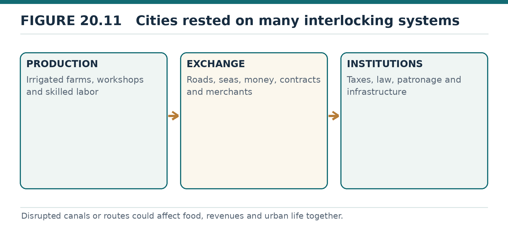

Просперирането на Багдад зависело от производството далеч отвъд Багдад. Напояваното селско стопанство в Ирак и Египет, текстилното производство, металообработването, керамиката, стъклото, производството на хартия, добитъка, ценните метали и търговията на дълги разстояния са свързани с много провинции и съседни общества. Търговци и пътешественици прекосиха Средиземно море, Червено море, Персийския залив, Централноазиатските кервани и Индийския океан. Парите, кредитните споразумения, писмените нареждания и доверените посредници помогнаха за намаляване на някои разходи за обмен, въпреки че маршрутите бяха опасни и практиките по сделките варираха.

Не си представяйте зона за свободна търговия без триене. Правителствата налагаха данъци, такси и монополи; пристанищата и пътищата можеха да бъдат несигурни; съперническите сили се бореха за стратегически места; робството и принудителния труд формираха част от някои икономически системи. Фермерите носеха напояване и тежести върху приходите, а градските богатства можеха да изчезнат чрез война или политическа конфискация. Икономическият растеж в един регион може да съществува едновременно с тежки неравенства другаде. Въпреки това мащабът на движението бил изключителен и стоките носели знания: хартия, научни текстове, култури, художествени техники, религиозни произведения и търговски практики, които всички пътували.

Перспективата на системите помага. Търговците се нуждаели от предсказуеми договори и транспорт; държавите се нуждаели от данъци и доставки; учените се нуждаели от покровители и книги; работилници се нуждаели от квалифициран труд и клиенти. Тези системи се укрепваха взаимно, когато условията бяха благоприятни. Те също могат да се провалят заедно. Повреденият канал намалява селскостопанската продукция, което намалява градските доставки и данъците, което от своя страна подкопава поддръжката на каналите. Обратните връзки на глава 7 не са абстрактни; те помагат да се обясни защо някои проспериращи региони станаха уязвими, въпреки че притежават напреднали институции.

<figure class="figure" id="figure-20-11">

<figcaption>Фигура 20.11. Разкъсаните канали или маршрути могат да повлияят на храната, приходите и градския живот заедно. <a class="figure-anchor" href="#figure-20-11" aria-label="Link to this figure">#</a></figcaption>
</figure>
