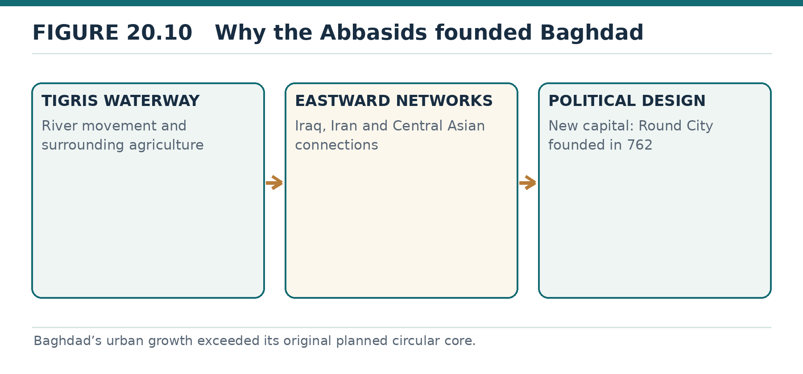

През 750 г. Умаядският халифат в сирийската си форма бил свален от движението Абасид, което твърдело, че се е спуснало от Ал-Абас, чичо на Мохамед. Революцията съчетавала религиозни претенции с регионални, военни и социални коалиции. Абасидите преместиха политическия център на изток и все повече се привлякоха към ирански, иракски и други административни традиции. Оцелелият принц Умайяд основал управляваща династия в Ал-Андал от 756, показвайки, че революцията в един императорски център не е сложила край на цялата власт на Умаяд навсякъде.

През 762, Абасид халиф ал-Mansur основана Багдад до Тигър, в близост до по-старите центрове на Месопотамско и Сасанян правило. Планираният Кръг Сити символизирал амбиция за изграждане на нов управителен център, въпреки че по - късният град нараснал далеч над този оригинален план. Мястото на Багдад е от значение. Той свързва речните маршрути, селскостопанските райони и мрежите за каравани, достигащи до Иран, Сирия, Залива и Централна Азия. Учени, търговци, занаятчии, длъжностни лица и религиозни фигури преминаха през градска среда, която извличаше ресурси от много региони.

Правилото на Абасид не трябва да се разглежда като постоянна златна епоха, в която политиката е престанала да има значение. Продължават споровете между съдилищата, провинциалната съпротива, военните разходи и наследяването. С течение на времето провинциалните династии придобили по - голяма автономия; по - късно Абасидските халифи понякога запазвали огромен религиозен престиж, като притежавали по - малко пряка военна власт. Семейство Абасид управлява като халифи в Багдад до 1258 г., но политическият и социален свят на девети век не може просто да се проектира непроменен за пет века.

<figure class="figure" id="figure-20-10">

<figcaption>Фигура 20.10. Градският растеж надвишава първоначалното си планирано кръгово ядро. <a class="figure-anchor" href="#figure-20-10" aria-label="Link to this figure">#</a></figcaption>
</figure>
