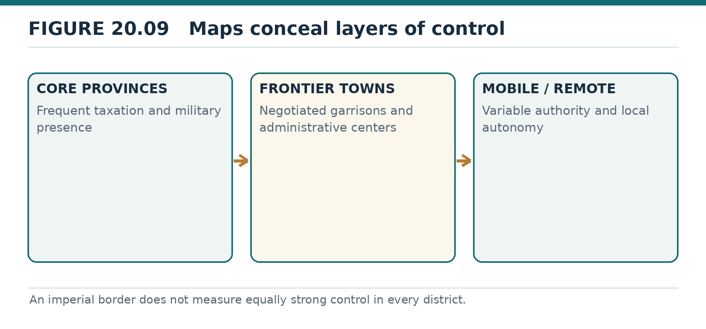

Под управлението на Умаяд мюсюлманските армии разширявали властта си в Северна Африка, навлизали в Иберийския полуостров през 711 г. и установявали власт в районите, достигащи до Трансоксиана и Синд. Тези експанзии не бяха непрекъсната, без триене вълна. В Северна Африка общностите в Амейзи се съпротивляваха, договаряха, преобразуваха и все повече участваха във военен и политически живот. В Иберия свалянето на висиготската заповед включваше арабските и Amazigh сили, местните политически разделения и променящите се съюзи. Централноазиатските градове и погранични общества поставиха свои собствени военни и дипломатически предизвикателства.

Следователно една линия на карта от учебник е опасно чиста. Тя крие гарнизони, приточни споразумения, бунтове, планински маршрути и местни управници, които запазват частична автономия. Завоеванието също не доведе до незабавно всеобщо преобразуване. Християнските общности издържали в Иберия, а други традиции продължавали да съществуват в Северна Африка и Азия. Балансът се променя през поколенията чрез институции, данъци, търговия, срочни бракове, покровителство и религиозно убеждение, а не само чрез включване в имперската граница.

Нито империята е контролирала всяка земя между далечни точки с еднаква интензивност. Граничните замъци, събиращите данъци градове, независимите планински общности и мобилните популации са имали различно управление. Когато обсъжда скоростта на разширяване, един внимателен историк чифтосва широкия териториален обсег на империята с карта на административната плътност: способността да се командват ресурси, прилагането на закона и получаването на точна информация става по-слаба или повече договорени от разстояние. Това е проблем, пред който са изправени всички големи империи - от Персия и Рим до халифатите.

<figure class="figure" id="figure-20-9">

<figcaption>Фигура 20.9. Имперската граница не измерва еднакво силен контрол във всяка област. <a class="figure-anchor" href="#figure-20-9" aria-label="Link to this figure">#</a></figcaption>
</figure>
