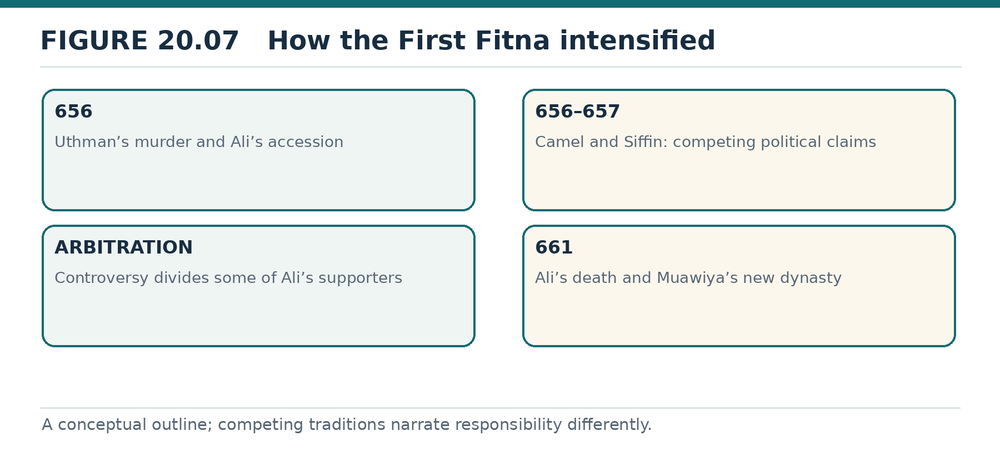

Али Ибн батко Талиб става халиф през 656 сред дълбокото деление. Той е братовчед на Мохамед и зет му, централна фигура в семейството на Пророка, и уважаван ранно вярващ. Борбата за политическа легитимност, отчетността за убийството на Утман и контрола над провинциите довели до Първата Фитна или до първата голяма гражданска война. Битката на Камелата през 656 г. и конфронтацията в Сифин през 657 г. станаха основни епизоди. Точните мотиви на отделни личности и групи са представени по различен начин в по-късните повествования; намаляването на конфликта до морална игра на чисти герои и злодеи би попречило на разбирането.

В Сифин конфликтът между поддръжниците и силите на Али, лоялни към Муакия, губернатор на Сирия и роднина на Умайяд, доведе до спорен опит за арбитраж. Някои бивши поддръжници на Али се противопоставиха на процеса и по-късно се превърнаха в групи, които по-късно бяха запомнени като харжити. Самите хариджитни движения били разнообразни и по - късно полярмичните описания можели да замъглят тази вариация. Али е убит през 661 г. от опонент, традиционно свързан с харихитите. Тези събития показват колко бързо несъгласието относно наследяването може да се превърне в спор за правото, справедливостта, религиозната власт и използването на сила.

За ученик на система за мислене, войната предлага болезнена обратна връзка. Смърт, създадена с искания за справедливост; съперническите власти не се доверяваха един на друг на способността си да разследват безпристрастно; въоръжената мобилизация задълбочи подозренията си; опитите за компромис отчуждиха някои поддръжници; насилието създаде нови оплаквания. Този обяснителен модел не заличава отговорността или приравнява всички участници. Това показва защо конфликт, който всеки може да опише като защита на човешкото единство, би могъл да го пречупи още повече. Дългосрочното въздействие беше огромно: конкурентните идеи на законния лидер сега бяха привързани към запомнени събития, семейства и мъченици.

<figure class="figure" id="figure-20-7">

<figcaption>Фигура 20.7. Концептуална схема; конкурентни традиции разказват отговорността различно. <a class="figure-anchor" href="#figure-20-7" aria-label="Link to this figure">#</a></figcaption>
</figure>
