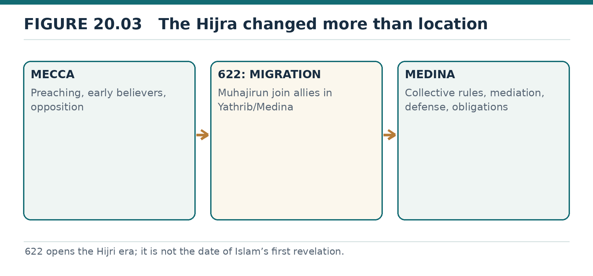

Решителната промяна дойде с миграцията на Хиджраамад с последователи от Мека до Ятриб през 622 г. В мюсюлманската хронология това събитие отбелязва началото на календара Хиджри; това не означава, че първото откровение се е случило през 622. Градът бил известен като Медина, градът и ролята на Мохамед се разширили от проповедник до посредник и политически лидер сред групи, които имали конфликт. Последователите, които мигрирали от Мека, станали известни като Мухаджирун, докато онези в Медина, които ги подкрепяли, били наричани ансар. Тези категории носеха мощен спомен за жертвоприношение и солидарност.

Документът, който често се нарича Конституцията на Медина, е особено важен. Версии, запазени чрез по-късни текстове, описват споразумения за членство в общността, взаимна помощ, уреждане на спорове и отношения между мюсюлманските групи и еврейските племена. Учените обсъждат дали оцелялата формулировка представлява един документ или свързани споразумения, съставени в различни моменти. Наричайки го първата модерна конституция ще наложи съвременни конституционни идеи на един много различен политически свят. Истинското му значение се крие в усилията за организиране на задължения между родствените отдели и създаване на колективни механизми за сигурност и арбитраж.

Хиджра ни учи на по-широк принцип за формирането на държавата. Общата вяра може да помогне на хората да си сътрудничат, но функциониращата общност трябва също така да организира храна, взаимна защита, разрешаване на конфликти, лидерство и задължения към външни лица. В Медина религиозната ангажираност и практическата политика станали неразделни. Ранната Умма, или общността, не е просто набор от частни вярващи; тя придобива форми на колективен живот. И все пак точният състав и политически статут на всички групи на Медина се промениха с течение на времето, а по-късните разкази не трябва да бъдат изравнявани в картина на постоянна хармония или постоянна враждебност.

<figure class="figure" id="figure-20-3">

<figcaption>Фигура 20.3. 622 отваря ерата Хиджри; това не е датата на първото откровение на Исляма. <a class="figure-anchor" href="#figure-20-3" aria-label="Link to this figure">#</a></figcaption>
</figure>
