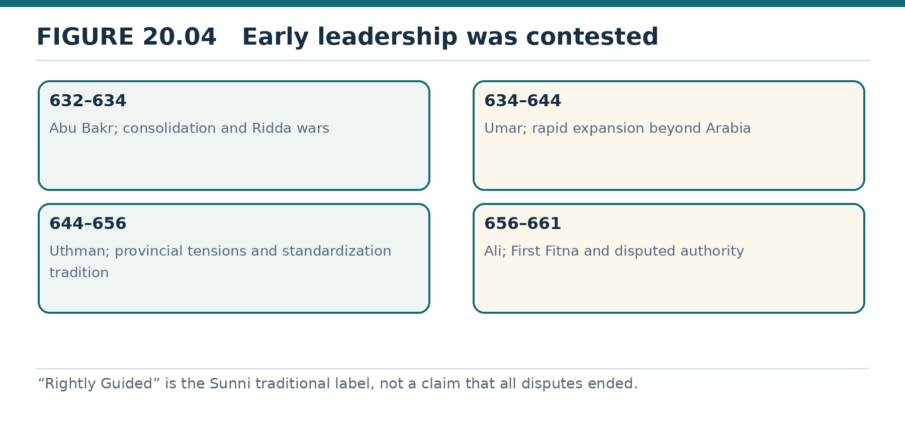

След смъртта на Мохамед, Абу Бакр станал първият халиф според историческата последователност, призната в главните хроники. Калиф произлиза от арабски термин, който означава наследник или заместник; той е дошъл да определи лидерството на мюсюлманската общност, въпреки че точният орган на офиса се е променил дълбоко с течение на времето. Първите четири халифа на Абу Бакр, Умар, Утман и Али са неофициално известни в сунитската традиция като Рашидун, или.. Шия Мюсюлманите поставят специален акцент върху законната власт на Али и ръководството на семейството на Пророка и не тълкуват цялата последователност по същия начин.

Тези различия не могат справедливо да бъдат сведени до аргумент за това кой е бил популярен. Те включват конкурентни разбирания на изявленията на Мохамед, общи консултации, родство, религиозна власт, справедливост и характера на лидерството. Историческите разкази на сунитите често подчертават легитимността на избора или приемането на халифите в ранната общност; традициите на Шия подчертават духовното и политическо значение на Али и семейството на Пророка (ал ал-байт). Напълно развитите доктринални разделения се оформят с течение на времето; те не трябва да бъдат представяни като две завършени купюри, стоящи един срещу друг на първия ден след 632.

Нито пък дебатът трябва да заличи незабавно онова, с което се сблъска ранната общност: диспарираните арабски групи имаха различни видове ангажименти. След смъртта на Мохамед, някои отхвърлили властта на Медина, устояли на плащанията или последвали алтернативни пророчески фигури. Кампаниите на Абу Бакр, традиционно наречени войните в Рида, се опитват да консолидират новата полити. Дали всеки опонент разбира конфликта като религиозно отстъпничество не е същият въпрос, както как победоносните мюсюлмански хроники класифицират бунтовете. Това е полезен пример за разликата между етикета на политически актьор и пълното обяснение на историк.

<figure class="figure" id="figure-20-4">

<figcaption>Фигура 20.4. Сюни традиционен етикет, а не твърдение, че всички спорове са приключили. <a class="figure-anchor" href="#figure-20-4" aria-label="Link to this figure">#</a></figcaption>
</figure>
