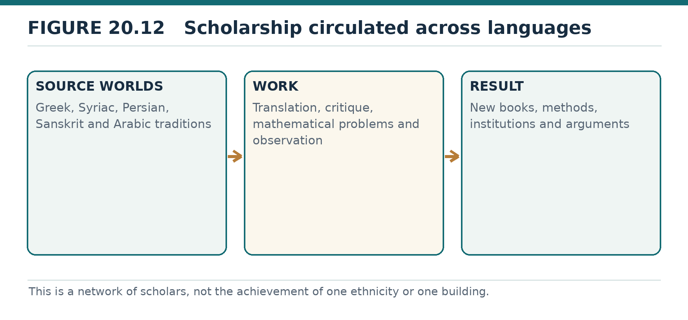

Абасидският съд и околните градски общества подкрепиха движението на книги, учени и технически познания на различни езици. Текстове, свързани с гръцката математика, медицина и философия, са преведени на арабски, често чрез работата на християнски сирийски говорещи учени и други обучени в множество интелектуални традиции. Персийската, санскритската и по - старото мезопотамско обучение също допринесло за по - широката научна среда. Терминът превод движение е полезно, но картината на една институция магически запазване на всеки древен текст е твърде проста. Преводът включваше много покровители, библиотеки, семинари и научни кръгове.

Името Bayt al-Hikma, или год. на Мъдростта, е свързано с Abbasid Багдад; историците не са съгласни за точната структура и функции на институцията в определено време. Тя не трябва да се представя като модерен университет с фиксирана учебна програма. Интелектуална дейност се проведе в съдилища, частни библиотеки, обсерватория, джамии, болници и домакинства, с различни нива на формална организация. Нито пък учените просто са копирали. Те критикували, реорганизирали, решавали проблеми и развивали нови подходи. Ал-Khwarizmi, активен през девети век, пише влиятелна работа по алгебра и изчисление; английската дума горска произлиза от латиноамериканска форма на името му. Тези събития привличат и трансформират по-ранните математически традиции.

По-широката история на науките в мюсюлманските общества включва фигури от много векове: лекарят ал Рази, философът и лекар Ибн Сина, а оптичният изследовател Ибн ал-Хайтам са добре познати примери, въпреки че не всички те принадлежат към едно и също поколение или град. Един честен акаунт кредити учени от различни вероизповедания и езици, разбира знанията като натрупване, и избягва да твърди, че всяко изобретение в голям регион е създаден от един недиференциран готварски. В Абасидския свят научните постижения били част от сложна социална инфраструктура от хартия, книжарници, покровителство, дебати, наблюдение и практическо търсене.

<figure class="figure" id="figure-20-12">

<figcaption>Фигура 20.12. Това е мрежа от учени, а не постижение на една етническа или една сграда. <a class="figure-anchor" href="#figure-20-12" aria-label="Link to this figure">#</a></figcaption>
</figure>
