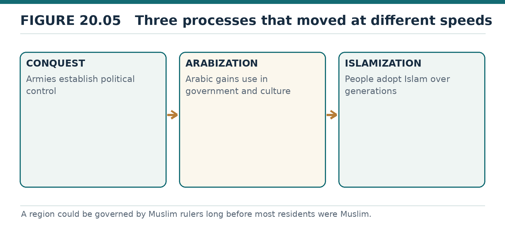

По време на халифата на Умар (634 и 644) мюсюлманските армии се разширяват далеч отвъд полуострова. Те победили византийските сили в Сирия и Палестина; Египет бил под мюсюлманско управление; а сасанската монархия претърпяла решителни поражения, като мюсюлманският контрол се разширявал през Ирак и Иран през следващите години. Битката при Ярмук (636) и борбата около Ал-Кадисия са видни в традиционните военни разкази, въпреки че подробности и точни дати в някои завоевателни сметки остават разисквани. Завоюването на Александрия и други египетски центрове включваше военни кампании, както и договорени взаимоотношения с местните власти.

Скоростта на разширяване представлява важен причинен пъзел. Религията и споделената политическа рамка помогнаха за мотивирането на някои участници, но те не бяха единствените причини. Лидерство, военна мобилност, коалиционно изграждане, достъп до плячка и приходи, изтощение на съперническите сили и настаняване на местно ниво. Войниците също наследиха пътища, земеделски райони, фискални системи и установен административен опит. Едно просто изявление, като например, че армиите спечелили, защото били обединени, не може да обясни защо някои кампании успели, а други се забавили или се провалили.

Новите владетели първоначално не изисквали всеки обект да се превърне в ислям. Повечето хора в Сирия, Египет, Ирак и Иран останаха членове на по-старите религиозни общности за значителни периоди. Някои градове видяха гарнизонни селища и преместване на данъци върху земята; други места задържаха институции при договорени условия. За да разбере ранния географски растеж на исляма, отличи териториалното завоевание от индивидуалното религиозно обръщане. Първата може да отнеме години; втората често се разраства през вековете и се различава от социалната класа и региона.

<figure class="figure" id="figure-20-5">

<figcaption>Фигура 20.5. Един регион може да бъде управляван от мюсюлмански владетели много преди повечето жители да бъдат мюсюлмани. <a class="figure-anchor" href="#figure-20-5" aria-label="Link to this figure">#</a></figcaption>
</figure>
