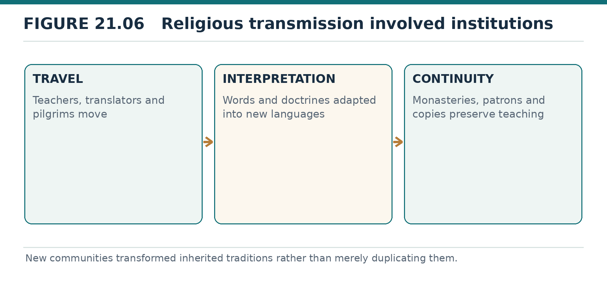

Будизмът започна в Южна Азия векове преди нашия период, но кръвообращението му през Централна Азия и Източна Азия засили взаимодействията между манастирите, съдилищата и търговските общности. Пътищата през басейна Тарим свързаха преводачите и поклонниците с традициите в Индия и Централна Азия. Будистките религиозни комплекси, включително пещерите на Могао близо до Дунхуанг, съдържат изображения и ръкописи, които осветяват как ученията са адаптирани и покровителствани. Грандиозните руини на Бамиян в Афганистан също свидетелстват за мащаба на будисткия артистичен и религиозен живот по пътищата, свързващи регионите.

Пътешественици като китайските монаси Faxian (ранно пети век) и Xuanzang (седми век) пътуват към Южна Азия в търсене на обучение и текстове. Техните разкази са ценни, защото са записвали условия за пътуване, политически пейзажи и религиозни общности. Но целта на пилигрима влияе на това, което той наблюдава. Той може да обсъжда манастирите по-подробно от селското стопанство в селото или живота на жените. Четенето на думите му заедно с надписи и археология създава по-пълна картина.

Предаването на будизма също се премести в нови посоки: китайски, корейски и японски съдилища и общности разработиха отличителни религиозни култури, вместо да правят идентични копия. Монасите превеждали стихове, управниците спонсорирали храмове и местните вярващи носели различни ритуални нужди. Религиозният обмен изисква институции, които са запазили ученето през поколенията, а не само хора, пътуващи по път веднъж. Тази институционална роля е мост към историята на университетите, библиотеките и научните мрежи в по-късните глави.

<figure class="figure" id="figure-21-6">

<figcaption>Фигура 21.6. Новите общности трансформирали по-скоро наследените традиции, а не само ги дублирали. <a class="figure-anchor" href="#figure-21-6" aria-label="Link to this figure">#</a></figcaption>
</figure>
