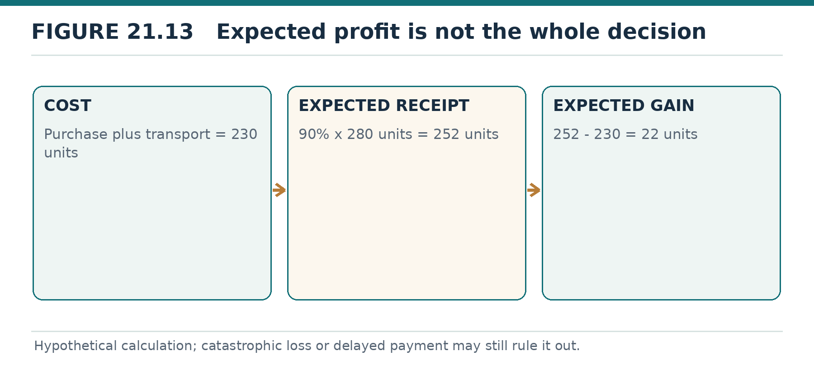

Търговец на дълги разстояния е изправен пред най-малко четири трудности: информация за цените, безопасността на транспорта, надеждните мерки и плащанията и изпълнението на споразуменията. Брокери, кредитни писма в някои търговски системи, партньорства, свидетели и повтарящи се сделки помогнаха за решаването на тези проблеми. Никой метод не работи навсякъде. Търговецът може също така да зависи от защитата, правните институции и митническите договорености на местния владетел. Гаранция, която работи в едно пристанище, може да не носи никаква власт в друг град.

Да разгледаме хипотетична пратка на стойност 200 счетоводни единици, когато са закупени. Транспортът, наемането на животни и таксите за такси добавят 30 единици. Търговецът вярва, че има 10% шанс цялата доставка да бъде загубена и ако пристигне, продажна цена от 280 единици. Проста очаквана брутна квитанция е 0,90 × 280 = 252; изваждането на 230 платени единици води до очакваната печалба от 22 единици, преди други разходи. Това е образователен модел, а не историческа печалба. Търговецът все още може да отхвърли търговията, защото загубата на 230 единици би могла да банкрутира домакинството; очакваната стойност не е цялото управление на риска.

Тези изчисления обясняват защо търговците са поискали маржове, различни маршрути, сборен капитал и ценна защита. Данъците могат да финансират пътища или да защитават градовете, но въпреки това прекомерните такси биха могли да отклонят търговията. Защитата може да дойде с политическа зависимост. Доверието било от решаващо значение, но търговията не била аполитическа сила, която естествено разпускала конфликта. Той действаше в борбата за власт и предимство.

<figure class="figure" id="figure-21-13">

<figcaption>Фигура 21.13. Хипотетично изчисление; катастрофална загуба или забавено плащане все още може да го изключи. <a class="figure-anchor" href="#figure-21-13" aria-label="Link to this figure">#</a></figcaption>
</figure>
