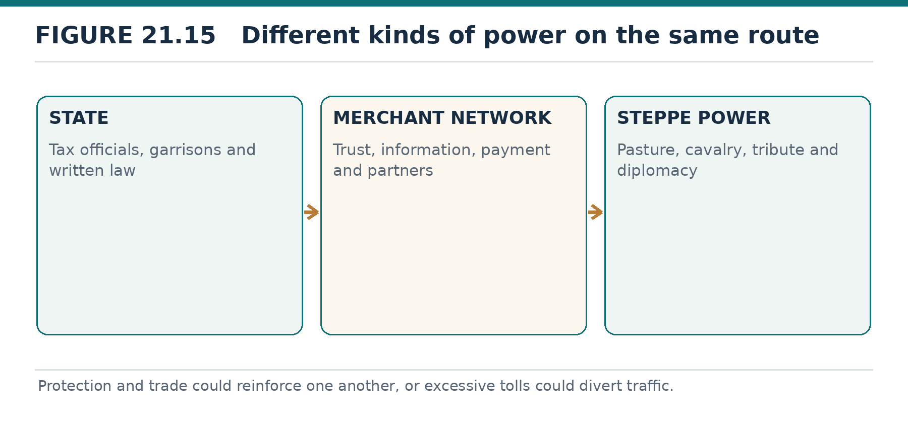

В една и съща история на Пътищата на коприната може да се появи чиновник от съда Танг, согдианско търговско семейство и степен владетел, но силата им идва от различни механизми. Длъжностното лице може да издаде държавни документи, да мобилизира данъци или да командва гарнизон. Търговецът може да свърже хора, които се доверяват на търговска репутация в градовете. Степният владетел може да контролира монтирани сили, сезонни маршрути и достъп до политически съюзи. Никой не беше неограничен. Писмената заповед не може да накара водата да тече през счупен канал; репутацията не може да спре всяко нападение; кавалерията не може постоянно да управлява град без мерки за снабдяване и управление.

Тези сили могат да ни съдействат. Една държава осигурявала полиция, търговец финансирал обмен и мобилна общност доставяла транспорт и коне. Те също можеха да се противопоставят, когато данъците, данъците, таксите или исканията за сигурност станаха прекомерни. Тук системната рамка на глава 7 става конкретна: изборът на всеки участник променя стимулите на другите. Защитата може да привлече търговията, която произвежда данъци, които финансират по-голяма защита на потенциално засилване на цикъла. Но един агресивен владетел може да изисква все по-високи такси, насърчавайки търговците да избират алтернативни маршрути и в крайна сметка да намалят приходите.

Разбирането на институциите, а не просто екзотични стоки, прави Пътите на коприната по-скоро обяснение на историята, отколкото музейна изложба. Постигането на средновековна Евразия не било глобално единство. Това беше широк набор от променящи се договорености, които направиха изненадващи връзки възможни без премахване на местното разнообразие, отдалеченост или политически конфликт.

<figure class="figure" id="figure-21-15">

<figcaption>Фигура 21.15. Защитата и търговията могат да се засилят взаимно, или прекомерните такси биха могли да отклонят трафика. <a class="figure-anchor" href="#figure-21-15" aria-label="Link to this figure">#</a></figcaption>
</figure>
