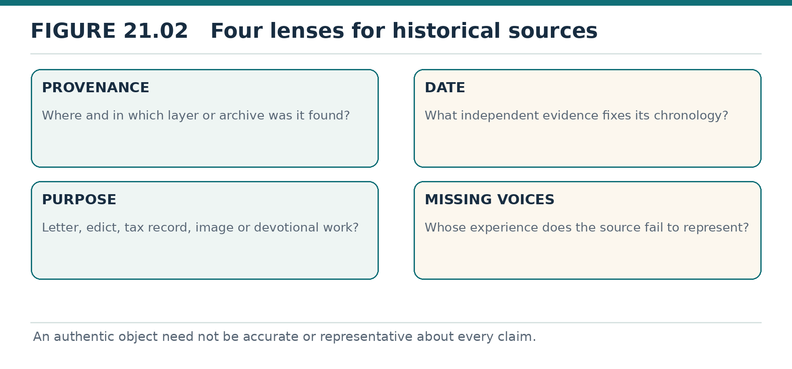

Историята на континенталния обмен изисква различни доказателства от историята на едно кралство. Археолозите разглеждат пътни легла, водопроводни машини, руини от хана, монети, керамика, текстил, корабокрушение и дори остатъци в контейнери. Филолозите четат документи на езици, вариращи от китайски и согдийски до тибетски, санскритски, арабски и гръцки. Художествени историци разследват стил и производствена техника. Изследователите на околната среда реконструират промените в реките, растителността и климата. Нито един архив не осигурява безпристрастна панорама.

Dunhuang в северозападен Китай е необичайно важно, защото ръкописи оцеляват в суха среда, включително и материали, намерени в известната библиотека пещера в Могао. Те осветяват религията, администрацията, местните договори, социалния живот, езиковия контакт и повторната употреба на хартия. Но оцеляването им е изключително. Трябва да се съпротивляваме да третираме необичайно богатия рекорд на Дънхуанг като доказателство, че всеки град по маршрутите изглежда точно като Дунхуан. Други общности пишат за материали, които разпадат или поддържат традициите устно; тяхното минало може да бъде трудно да се възстанови.

Един полезен метод е да зададеш четири въпроса. Прованс: къде и в какъв контекст е открит обектът? Дата: какво независимо поддържа хронологията му? Функция: Домашно писмо, религиозен образ, данъчна разписка, държавна прокламация или ритуален подарък? Представителство: чии животи липсват от него? Един имперски указ може да обяви какво иска да се случи едно правителство; той не показва, че всеки далечен служител се подчинява. Ядосаното писмо на търговеца може да документира истинска криза, но не и да докаже, че цялата търговия се срина навсякъде. Историческата реконструкция е най-силна, когато се събират независими доказателства.

<figure class="figure" id="figure-21-2">

<figcaption>Фигура 21.2. Автентичен предмет не е необходимо да бъде точен или представителен за всяко твърдение. <a class="figure-anchor" href="#figure-21-2" aria-label="Link to this figure">#</a></figcaption>
</figure>
