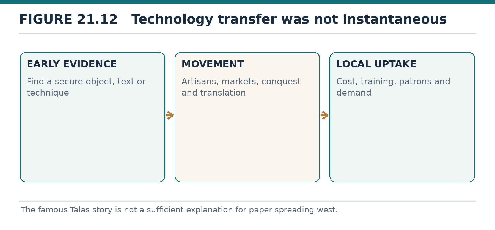

Ученически обменът не беше пасивен поток, течащ в една посока. Математическите писания с южноазиатски корени бяха разгледани в арабски език стипендия; гръцки философски и медицински традиции са били преведени и разисквани чрез сирийски и арабски; китайски будистки преводачи, работещи с текстове, чиито значения трябваше да бъдат тълкувани през традициите; астрономи комбинирани наблюдения, математически моделиране и наследени записи. В резултат на това работата често надхвърляше превода в критика и иновации.

Лекар, използващ преведен медицински текст, се нуждаел от нещо повече от езикови познания. Условията за тялото и заболяването трябва да бъдат направени разбираеми; леченията могат да бъдат адаптирани към местните съставки и практика; претенциите могат да бъдат сравнени с опита. Един математик, получаващ цифрови техники, може да ги комбинира с нови проблеми в данъчното облагане, проучването или търговията. По този начин историята на знанието не е раса между уж изолираните, за да притежават откритието. Това е история на хора, които се учат от по-ранни общности и понякога правят истински нови дарения.

Институциите имаха значение. Манастири, джамии, съдилища, домакинства, библиотеки, племенни работилници и училища могат да запазят книгите и да плащат на хора с познания. Същите мрежи също могат да изключат хора, на които им липсва статут, пари или разрешение. Обменът на знания има политически и материални условия: ръкописът трябва да оцелее, някой трябва да може да го прочете, а някои институции или покровители трябва да направят копирането, преподаването или наблюдението възможно.

<figure class="figure" id="figure-21-12">

<figcaption>Фигура 21.12. Известната история на Талас не е достатъчно обяснение за разпространението на хартия на запад. <a class="figure-anchor" href="#figure-21-12" aria-label="Link to this figure">#</a></figcaption>
</figure>
