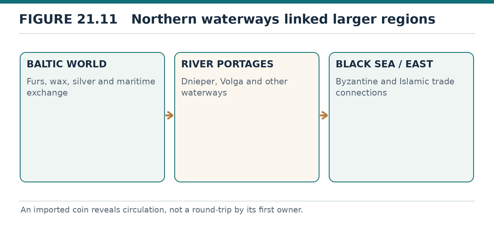

Друга карта на средновековната Евразия следва реките, а не пустините. Навигативните водни пътища и пунктовете за пренос свързват балтийския свят с Черно море и отвъд него. Скандинавските пътешественици с произход, често наричани варангианци от източни източници, взаимодействали със славянски, финически, степи и византийски общества. Политическата формация обикновено се нарича Киев Рус "развити чрез тези срещи, регионални борби за власт и растежа на градовете и династични институции. Никоя проста история за аутсайдери изобретяващи държава или етнически униформени хора, действащи самостоятелно, не улавя сложността.

Търговията пренася кожи, восък, роби, метали и други стоки през речните системи. Монети от ислямски земи са открити в Северна и Източна Европа; тези илюстрират контакти, но не доказват, че хората, които ги погребаха лично са посетили халифата. Те могат да циркулират през много междинни обмени. Престижът на Константинопол привлича дипломати и владетели; обръщането на Владимир Киев към християнството около 988 г., както традиционно се разказва, става важно за религиозната ориентация на по-късните източни славянски общества. Датите и детайлите на отделните епизоди трябва да бъдат оценени спрямо хроникалните традиции и други доказателства.

Тази северна мрежа също ни напомня, че Пътите на коприната не са били цялата евроазиатска свързаност. Северните гори, реките, степните проходи и морските алеи се присъединиха към търговски светове на различни разстояния. Маршрутите имаха значение отчасти, защото свързваха различни екологии и продукти: северни региони, средиземноморски пазари и пасторални общности в Централна Азия биха могли да бъдат свързани без човек да движи стоки от една крайност до друга.

<figure class="figure" id="figure-21-11">

<figcaption>Фигура 21.11. Вносната монета разкрива циркулацията, а не обиколката на първия собственик. <a class="figure-anchor" href="#figure-21-11" aria-label="Link to this figure">#</a></figcaption>
</figure>
