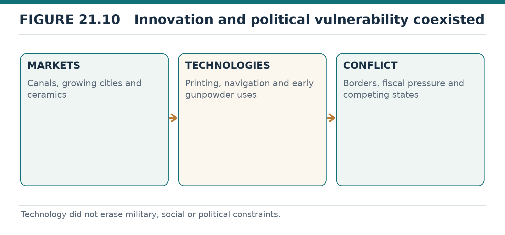

След падането на Тан през 907 г. Китай преживява периоди на политическо разделение преди обединението по династията Сонг, започвайки през 960 г. Сонг развива сложна администрация, търговски градове и разширяване на пазарната активност, въпреки че нейните управници също са изправени пред сериозен военен натиск от страна на северните съседи. Земеделието, водните пътища и градските потребители подкрепиха важни отрасли. Кайфенг и по-късно Ханджоу станаха основни центрове на производство и потребление. Правителственият транспорт, частното предприятие и технологичните техники взаимодействаха вместо да образуват отделни светове.

Китай от Сонг-ера е видял значителни разработки в печатането, навигацията, металургията и военната употреба на барут. Но не бива да се бъркаме с това, че във всяко село се появява веднага в Европа. Различни устройства са имали по-ранни истории, били са рафинирани постепенно и достигнат нови места чрез несигурни пътища. В Източна Азия преди Песента е бил използван печат на дървени блокчета; движим тип, разработен в Китай през единадесети век, но е само една технология сред няколко, адаптирани към езиковите и икономическите условия. Съществуването на дадено устройство не гарантира търговска полезност във всяка обстановка.

Песента за морската търговия се разширява заедно с вътрешния транспорт. Китайската керамика се разпространява широко в Азия и извън нея; тяхното разпространение показва търговски обхват, но не и централно планирана глобална стратегия за износ. Политическата конкуренция с държавите Лиао, Западна Ся и Джин помага да се обясни защо военните и фискалните искания продължават да бъдат натискани дори на фона на културните и търговските постижения. Обществото може да бъде иновативно, богато и стратегически уязвимо едновременно.

<figure class="figure" id="figure-21-10">

<figcaption>Фигура 21.10. Технологията не е изтрила военните, социалните или политическите ограничения. <a class="figure-anchor" href="#figure-21-10" aria-label="Link to this figure">#</a></figcaption>
</figure>
