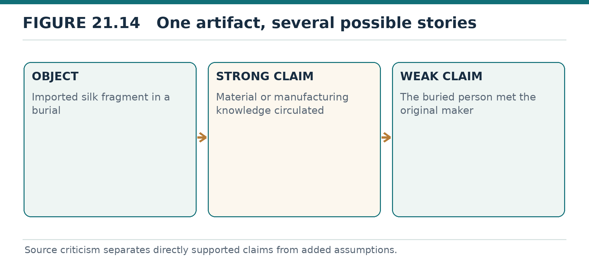

Представете си три източника, поставени на бюрото на историк. Първият е копринен фрагмент, намерен в средновековно централно азиатско погребение. Втората е сметка за пътуване на монах, описваща манастирите на чужд град. Третият е надпис на владетел, обявяващ сигурност по търговски маршрут. И трите може да са автентични, но те са доказателство за различни твърдения.

Текстилът може да се изучава за влакната, тъканта, боята и археологическия контекст. Присъствието му показва, че материалът е пътувал или бил направен с помощта на техники, които се разпространяват, но не може независимо да докаже кой го е транспортирал или защо е бил погребан. Пилигримът може да е наблюдавал манастирите директно, но също така имал религиозна цел и можел да разчита на местни водачи или слухове за някои доклади. Кралският надпис документира твърдението и политиката на владетеля, а не пълното поведение на пазачите на стотици километри разстояние.

Силно обяснение съчетава тези източници, без да ги принуждава да говорят твърде много. Тя може да добави монети, които разкриват политически претенции, договори, които документират търговска практика, или изкопани водни канали, които показват как един град устойчиви пътници. Стойността на даден източник се отнася до зададения въпрос. Този принцип, въведен в глави 1 и 4, става особено мощен, когато доказателствата са разпръснати по континенти и езици.

<figure class="figure" id="figure-21-14">

<figcaption>Фигура 21.14. Критиката на източника разделя пряко подкрепя твърденията от допълнителните предположения. <a class="figure-anchor" href="#figure-21-14" aria-label="Link to this figure">#</a></figcaption>
</figure>
