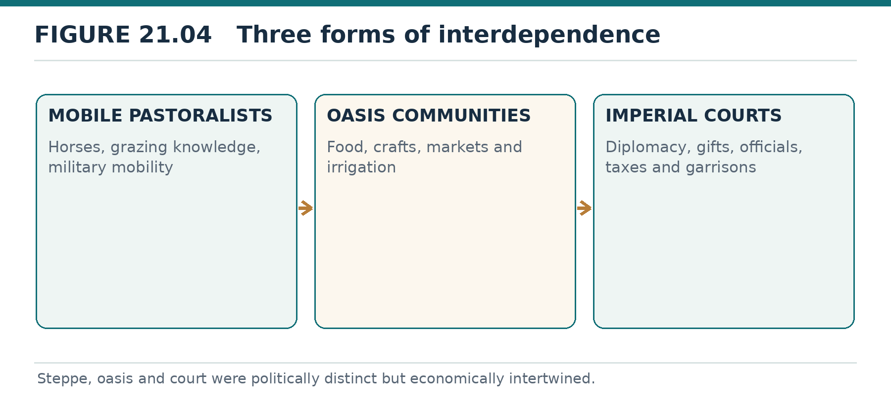

Големият обмен също зависеше от света на пасищата. Турската конфедерация, уйгурските владетели, тибетците, Китан и много други групи оформиха политиката на Вътрешна Азия. Терминът степ описва екологична зона, а не една цивилизация, религия или постоянна етническа идентичност. Мобилният пасторализъм разчиташе на експертни познания за сезонните пасища и животни и би могъл да подкрепи огромни кавалерийски сили. Много мобилни общности комбинираха стадата с търговия, занаятчийски дейности, земеделие, нападения или почетни връзки. Номад и фермерът не бяха запечатани категории.

През шести век първият тюркски хаганат се появил като голяма политическа сила във вътрешната Азия. По-късно турските сили взаимодействаха с китайски династии, централноазиатски градове и иранскоговорящи търговски общности. Управителите биха могли да предложат защита, да търсят данъци или данък, да се намесват в спорен наследяване, да контролират достъпа до пропуски и да предоставят военни услуги. Uyghur Khaganate, например, придоби значително влияние върху Tang Китай през осми век преди колапса му през 840. Неговата политическа история показва защо търговецът не може да съди за безопасността от богатствата на само една империя.

По-старите учебници понякога представят степта просто като източник на нашествия срещу установените цивилизации. Това пропуска взаимната зависимост. Устроените владетели търсели коне, военна помощ и дипломатически съюзи; степните елити търсели текстил, зърно, престижни стоки и достъп до пазарите. Споразуменията биха могли да създадат мир, но конфликтът беше повтарящ се и разрушителен. Мрежата за обмен не беше отделена от властта: същите хора, които транспортираха стоки, можеха да прилагат споразумения или да заплашват пътищата, които са използвали.

<figure class="figure" id="figure-21-4">

<figcaption>Фигура 21.4. Степ, оазис и съд бяха политически различни, но икономически преплетени. <a class="figure-anchor" href="#figure-21-4" aria-label="Link to this figure">#</a></figcaption>
</figure>
