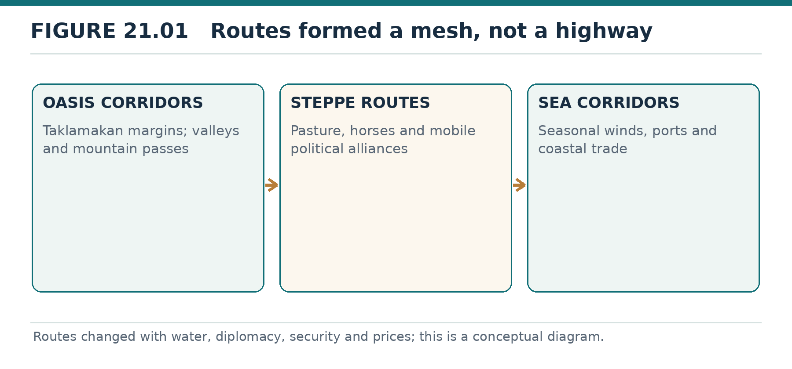

Една плоска линия през модерна карта прикрива трудността да се преместиш в Евразия. Между Северен Китай и Източното Средиземноморие се намират пустини, високи планини, пасища и плодородни речни долини. Такаламаканската пустиня принудила много пътешественици към оазисните вериги около краищата си. Планините Тиен Шан, Памир и Хинду Куш предлагаха проходи, но времето и височината бяха ограничени, когато се използваха. Напоените долини около места като Самарканд, Бухара и Мерв доставяли храна, животни и опитен труд; способността им да поддържат пътуващите зависела от управлението на водите и политическата сигурност. Широкият степен пояс на север подкрепя мобилните пасторалисти, чиито транспортни, военни и дипломатически роли са от основно значение за континенталния обмен.

Нямало е постоянен, универсален маршрут или маршрут. Пътешествениците се приспособявали към династичните граници, разрушен мост, могъщ клан, суша, избухване на боеве или местоположението на надеждни партньори. В някои десетилетия един маршрут процъфтявал, защото една държава можела да предложи сигурност; в други търговци се преместили към реката или морските проходи. Търговец, избиращ между два пътя, смятан за повече от километър. По-дългият път с надеждни кладенци и познати посредници може да струва по-малко от един по-кратък, който вероятно ще загуби животни и товари.

<strong>Географията ограничава избора, но не диктува резултатите.</strong> Пустинните градове не станаха важни само от пустинята: хората, инвестирани в канали, стени, пазари, светилища, каравани и системи на кредит и доверие. По същия начин моретата не били нито празни пространства, нито автоматични бариери. Предстоящи ветрове, пристанища, корабостроителни познания и крайбрежни търговски общности ги направиха коридори. Географията обяснява защо сътрудничеството е ценно; институциите помагат да се обясни, когато това сътрудничество работи.

<figure class="figure" id="figure-21-1">

<figcaption>Фигура 21.1. Пътищата се променят с вода, дипломация, сигурност и цени; това е концептуална диаграма. <a class="figure-anchor" href="#figure-21-1" aria-label="Link to this figure">#</a></figcaption>
</figure>
