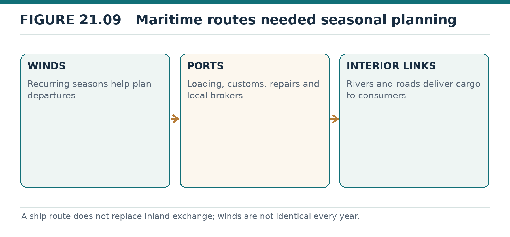

Карта, фокусирана само върху караваните в Централна Азия ни дава непълна средновековна Евразия. Морските мрежи свързват пристанищата около Арабско море, Персийския залив, Червено море, Бенгалския залив и Южнокитайско море. Моряците използват повтарящи се сезонни модели на вятъра, включително системата за мусоните в Индийския океан, въпреки че планирането на пътуванията зависело от местните условия и познания. Търговски общности в пристанища като Siraf, Aden и пристанища по бреговете на Индия обмениха стоки и информация с Източна Африка и Югоизточна Азия. Различни маршрути се повишиха и паднаха с търговски и политически обстоятелства.

Морските превози биха могли да се движат по-масивни количества от много стоки по-ефективно, отколкото глутници животни, но това не беше универсален закон, независим от размера на корабите, бури, пиратство, пристанищни такси и вътрешен транспорт. Един товар, достигащ пристанището, все още се нуждаел от речни лодки, каруци или човешки труд, за да достигне до потребителите във вътрешността на страната. Корабите не могат просто да заменят връзките с оазисните градове, тъй като много дестинации и ресурси са разположени далеч от брега. Овърленд и морските системи са конкуренти, алтернативи и допълнения в същото време.

Историите за морска търговия понякога рухват в романтичен образ на търговец, който се движи направо от Багдад към Китай. Действителните пътувания често включваха междинни пристанища и множество търговци; някои стоки пътуваха по - далеч от хората, които първи ги продадоха. Морските архиви и корабокрушението ни казват за маршрутите, но корабите оцеляват неравномерно. Корабокрушението в Белитунг през девети век, открито близо до Индонезия, осигурява поразителни доказателства за керамика и други стоки, движещи се из морската Азия, въпреки че точният маршрут не се възстановява напълно само от товара.

<figure class="figure" id="figure-21-9">

<figcaption>Фигура 21.9. Маршрутът на кораба не заменя вътрешната търговия; ветровете не са идентични всяка година. <a class="figure-anchor" href="#figure-21-9" aria-label="Link to this figure">#</a></figcaption>
</figure>
