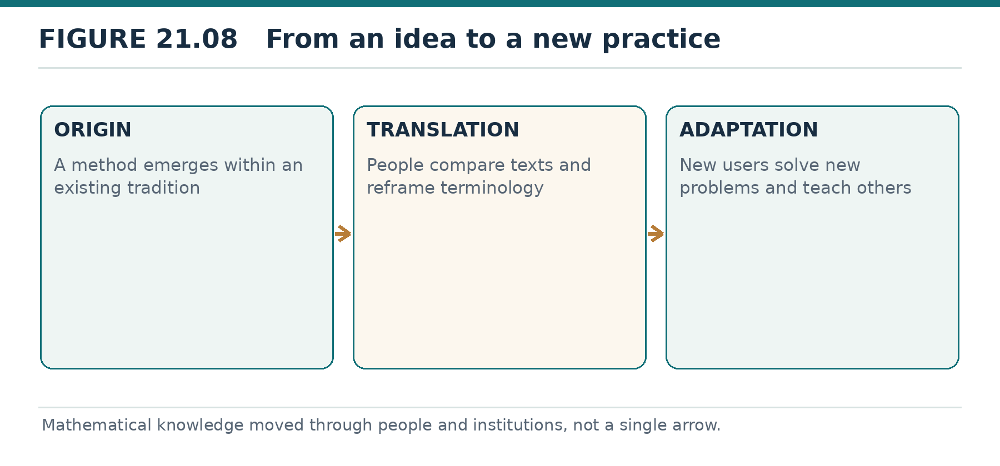

Южна Азия твърде често се показва като празно пространство между Китай и ислямския свят. В действителност индийските селскостопански райони, пристанища, поклоннически центрове и съдилища били източници на стоки, идеи и квалифицирани пътешественици. Търговците пренасят текстил, подправки и други стоки в различни маршрути и количества. Индийските религиозни и интелектуални традиции повлияли на Източна и Югоизточна Азия чрез сложни процеси на пътуване и локална адаптация. Будисткото обучение привлече посетителите към центрове като Наланда, чиито археологически и текстови записи осветяват вековната образователна дейност.

Политическата история беше разнообразна. След периода Гупта регионалните държави се появили и се състезавали в северна и южна Индия, а династията Пала в Източна Индия станала важен патрон на будизма. По - късно владетелите на Чола в Южна Индия разработили големи храмове, земеделски, морски и военни мрежи, особено през десети до тринадесети век. Техните връзки с Югоизточна Азия показват защо наземните маршрути не разказват цялата история. Не всеки търговец, плаващ от индианско пристанище, обслужвал интересите на едно кралство; пристанищните градове често свързвали припокриващи се търговски общности.

Историческото движение на математическите концепции предлага друг пример за медииран обмен. Десетичната система на място и формите на изчисление, разработени в Южна Азия и са били предавани, изучавани и адаптирани на арабски език стипендия преди разпространението по-широко. Наричайки ги "Арабски цифри" в съвременната европейска терминология улавя един етап на предаване, а не цялата история на изобретението. Историята на една концепция може да включва произход, превод, модификация и осиновяване от различни хора през вековете.

<figure class="figure" id="figure-21-8">

<figcaption>Фигура 21.8. Математически знания преместени чрез хора и институции, нито една стрела. <a class="figure-anchor" href="#figure-21-8" aria-label="Link to this figure">#</a></figcaption>
</figure>
