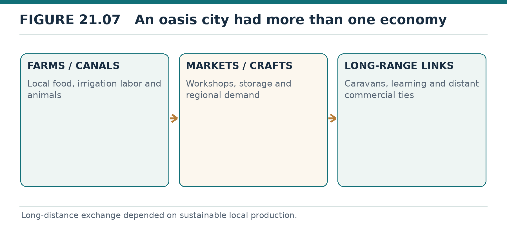

Глава 20 следва възхода на исляма и ранните халифати. До девети и десети век учените и търговците можели да използват арабски в големи райони, докато персийски, местни ирански езици, тюркски езици и много други останали важни. Багдад е голям интелектуален и търговски град, но това не е един пазар или културен център на иначе пасивен свят. Басра, Нишапур, Мерв, Бухара, Самарканд, Кайро и много други центрове имаха свои собствени функции. Политическата фрагментация може да съществува съвместно със споделени правни, литературни и търговски мрежи.

Под династията Саманид в Централна Азия, особено през девети и десети век, Бухара става основен център на персийската и ислямската култура. Други регионални управници и търговски общности свързаха Централна Азия с Иран, Индия, степта и Китай. По-късно Ghaznavid и Seljuk власт преформулира политически договорености в части от региона. Селджук бяха владетели с тюркски произход, чието разширяване в Иран и Близкия изток промени баланса на военната сила и патронажа. Междувременно Караханидите изиграха важна роля в ислямизацията и политическата трансформация на части от Вътрешна Азия.

Нищо в тази история не трябва да предполага универсална, мигновена замяна на предислямската централна азиатска култура. Ислямизацията беше неравна; езикът, семейството и местната практика се промениха през поколенията. Джамиите, религиозните училища и правните общности предлагат нови видове приемственост, докато градовете продължават да зависят от напояването и търговията. Една промяна на династия може да прекъсне данъчното споразумение, без да прекъсва език, занаятчийска традиция или религиозен обичай. Тази разлика е от решаващо значение за тълкуването на средновековния свят.

<figure class="figure" id="figure-21-7">

<figcaption>Фигура 21.7. Обменът на дълги разстояния зависи от устойчивото местно производство. <a class="figure-anchor" href="#figure-21-7" aria-label="Link to this figure">#</a></figcaption>
</figure>
