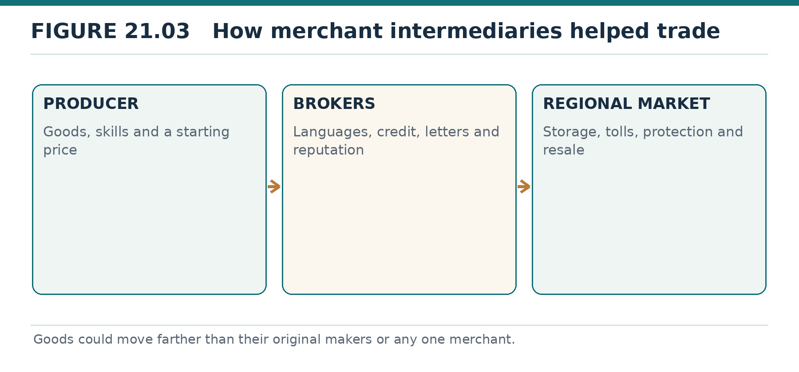

Между иранския свят и Китай, согдиански говорещите общности, базирани около Самарканд и съседните части на Централна Азия, стават видни търговци и културни посредници, особено от четвърти до осми век. Диаспората им се простирала в оазисни градове и китайски градове. Семействата поддържаха търговски връзки, писма и местни взаимоотношения; някои хора служеха като преводачи или администратори. Те не са нито едно обединено дружество или изключителен монопол. Други централноазиатски, индийски, китайски, ирански и по-късно мюсюлмански търговци търгуват заедно и понякога срещу тях.

Согдианските търговци са мощен урок защо социалните мрежи могат да заменят отдалеченото централно управление. Ако двама души използват различни валути, закони и езици, доверен брокер може да обясни тежести, да организира съхранение и гарантира за длъжник. Киншип и диаспората понякога придавали увереност, която непознат не можел лесно да осигури. Но мрежите също така създават неравенства между вътрешни и външни лица. Откриването на согдиански писма, забавни предмети и надписи разкрива както връзки, така и индивидуални трудности; то не превръща всеки Согдиан в богат международен търговец.

Согдианците също преместили истории, изображения и религиозни идеи. Някои практикуваха форми на зороастризъм, докато согдийските общности участваха и в будистките, манихейските и християнските традиции. Религиозната идентичност се променя със семейства, места и поколения. Tang-период Китай прие Централна Азия музика, танц и костюми елементи; чужди изглеждащи фигури се появяват в изкуството и мебели за гробница. Тези предмети се оказват очарование и размяна, въпреки че не ни казват, че всеки обитател на Чанг'ан е приветствал чужденци. Трейдърите помогнаха за създаването на космополитизъм, но политическото приемане беше условно.

<figure class="figure" id="figure-21-3">

<figcaption>Фигура 21.3. Стоките могат да се движат по-далеч от първоначалните си производители или всеки един търговец. <a class="figure-anchor" href="#figure-21-3" aria-label="Link to this figure">#</a></figcaption>
</figure>
