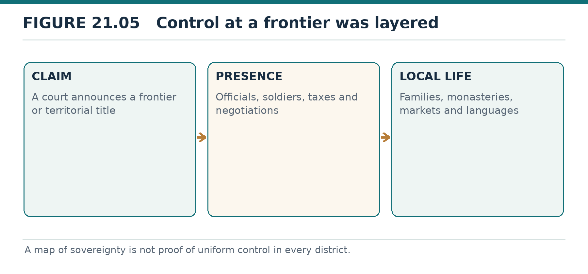

Тибетската империя, особено от седми до девети век, била една от най-големите държави в Азия. Тибетските владетели се състезавали и преговаряли с Тан Китай, управлявали територии през предизвикателно плато и контролирали някои стратегически важни маршрути около басейна Тарим по различно време. Тяхната сила идва от политическа организация, съюз-билдинг, армии и достъп до Хайланд не само от височина. Разширяването на Тибет показва, че условията за пътуване на търговците са оформени от конкурентни държави, чиито приоритети често нямат нищо общо със самата търговия.

Тибетските съдилища също покровителстваха будизма, който се превърна в траен елемент на тибетския религиозен живот, дори когато се развиха практики и институции. Будистки текстове се преместват между езици и региони; преводачите са изправени пред проблема да изразят непознат философски речник в новите езикови рамки. Следователно движението на религиозни идеи не било процес на просто копиране на книга. Тя включваше интерпретация, преподаване, дебати, патронаж и създаване на нови институции.

Дънхуанг преминава под тибетското управление за значителна част от края на осми и девети век, а оцелелите многоезични ръкописи отразяват припокриващи се културни и политически светове. Един текст, написан в Тибет, може да ни разкаже за превода, официалната практика или местната религиозна общност в зависимост от нейния контекст. Един полезен въпрос за всяка гранична земя не е просто "Кой го притежава?," но "кои органи биха могли да плащат данъци, съдия, защита, преподаване или командване там, и през кои години?

<figure class="figure" id="figure-21-5">

<figcaption>Фигура 21.5. Картата на суверенитета не е доказателство за единен контрол във всяка област. <a class="figure-anchor" href="#figure-21-5" aria-label="Link to this figure">#</a></figcaption>
</figure>
