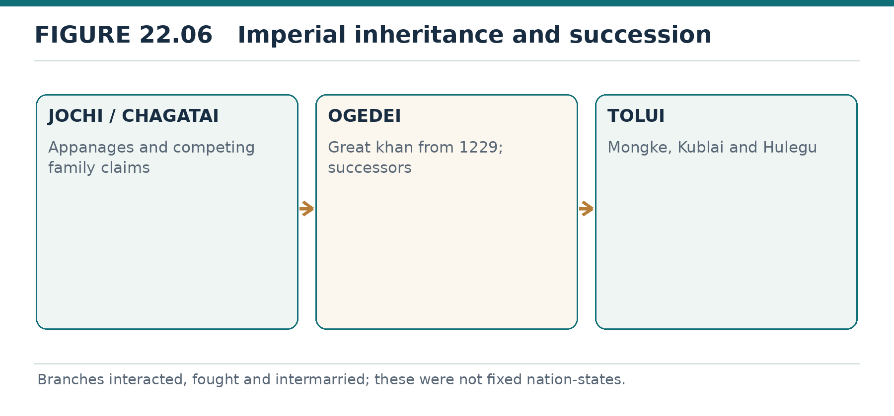

Смъртта на Чинггис Хан не сложи край на монголската експанзия. Неговите потомци наследили територии, военни последователи и твърдения, свързани с различни клонове на управляващото семейство. Традиционните разделения, свързани с линиите Йочи, Чагатай, Огедей и Толуй, не бяха нито четири модерни държави, нито напълно фиксирани граници. Имперското семейство управляваше големи апанации и припокриващи се права, докато великият хан твърдеше върховна власт. Наследството на обединенията и политическото договаряне е определено, но конкурентните роднини могат да оспорват резултата.

<strong>Ögedei</strong> става велик хан през 1229 и председателства големи нови кампании. Съдът се развива в Каракорум в Монголия, където гостуващи пратеници срещат политически център, свързан с огромни региони чрез мъже и послания. След смъртта на Йогедей през 1241 г. споровете за наследяване и регенциите се засилиха. Töregene Khatun, неговата вдовица, упражнява власт по време на регентство, както и нейните решения оформени елитна политика. По-късно Sorghaghtani Beki изигра решаваща роля в напредъка на синовете си, сред тях Möngke и Kublai. Централната позиция на тези жени е доказателство, че монголската сила не е просто верига от мъжки войни, въпреки че възможностите им са били обусловени от аристократичен статут и династична политика.

Тази семейна система бързо разширила империята, но носела противоречие. Колкото по-големи са разстоянията между кралските дворове и богатите завоювани региони, толкова по-окуражаващи се местни управници трябвало да поддържат ресурси и сами да контролират наследяването. Институциите, които направиха императорското разширяване възможно, също биха могли да насърчат разпокъсаността. Ще видим това противоречие ясно в Златната орда, Илханат и династията Юан.

<figure class="figure" id="figure-22-6">

<figcaption>Фигура 22.6. Клоновете си взаимодействаха, воюваха и се женеха помежду си; това не бяха фиксирани национални държави. <a class="figure-anchor" href="#figure-22-6" aria-label="Link to this figure">#</a></figcaption>
</figure>
