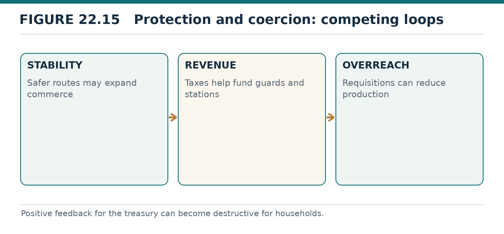

Разширяването на империята зависело от пасищата, тревопасните животни, районите за производство на зърно, данъчното облагане и търговията. Въпреки това средата на басейна на Жълтата река, централноазиатските оазиси, иранското плато и западноевропейските равнини бяха различни. Влаченето, суровите зими, селскостопанските щети, нестабилното данъчно облагане или местната съпротива биха могли да отслабят капацитета за подкрепа на армии и съдилища. Учените обсъждат ролята на климата във времето на степните завоевания и по-късните кризи; нито една проста температурна графика не доказва защо определен хан нахлува в един град.

Финансовият проблем беше също толкова важен. Завоевателите биха могли да изземат богатството веднъж, но дълготрайна държава се нуждаела от повтарящи се приходи. Прекалената заявка може да унищожи продуктивната база, която се надяваше на данъци. Местните администратори трябвало да познават домакинствата, културите, пътищата и цените. Корупцията или конкуренцията сред длъжностните лица могат да направят политиката противоречива. Един владетел, който поръчал по - ниски данъци, може да се опита да го наложи в провинция, където войниците изисквали доставки.

Мисли за императорското правителство като система с обратна връзка. Успешната защита може да увеличи търговията и приходите; по-големите приходи могат да финансират станции и войски. Но исканията за повече войници могат да предизвикат реквизиции, полети и намаляваща продукция, в крайна сметка отслабвайки държавата. Засилващи и вредни вериги, управлявани, както и различни региони следваха различни траектории. Това е апаратът, който се представя в глава 7, приложен към една истинска историческа империя.

<figure class="figure" id="figure-22-15">

<figcaption>Фигура 22.15. Положителната обратна връзка за хазната може да стане разрушителна за домакинствата. <a class="figure-anchor" href="#figure-22-15" aria-label="Link to this figure">#</a></figcaption>
</figure>
